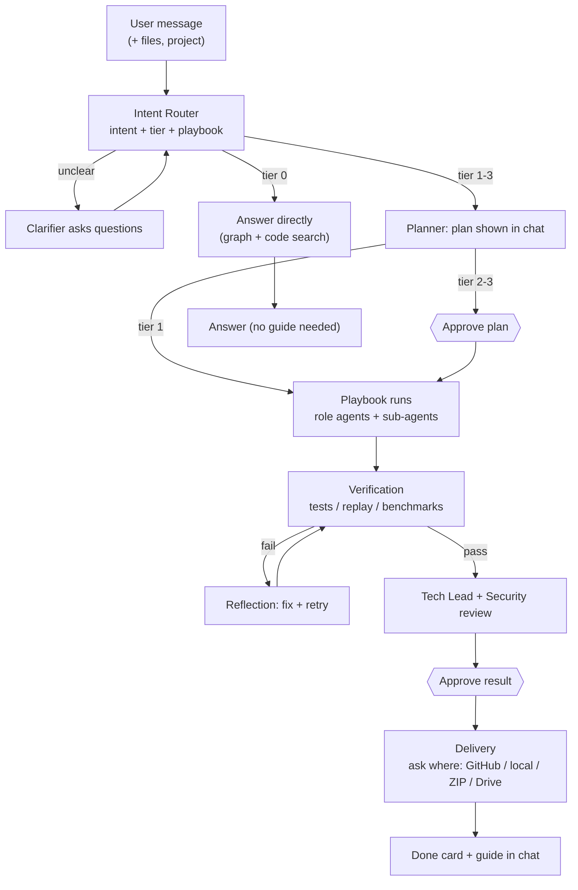
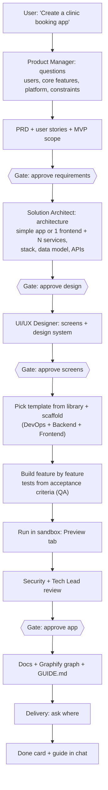
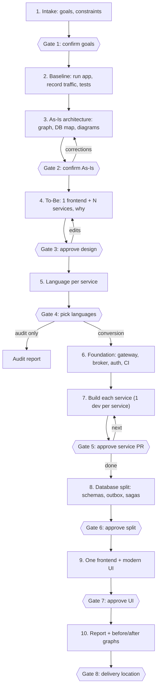
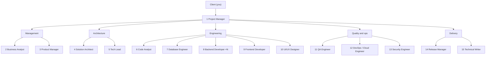
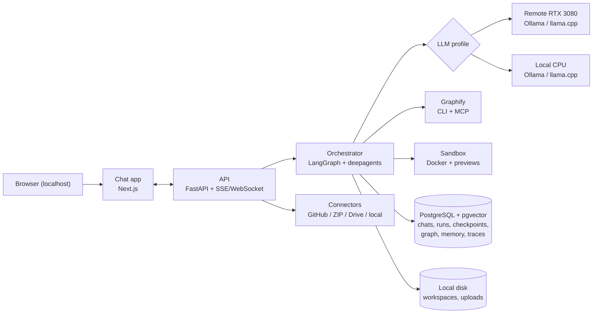

# Codewright

**A self-hosted AI software house in a chat app.**
You chat with Codewright the way you chat with Claude or ChatGPT. Behind the chat, a team of 15 AI roles (project manager, architects, developers, QA, DevOps, security, designers and more) does real software work on your code. It can write code, create new projects of any size, review code, and explain, fix, test, refactor, speed up, secure, upgrade, extend, re-architect and deploy existing ones, in **C++, TypeScript, JavaScript (React, Next.js), Go and Python**, with any architecture. It has Claude-style **skills** (slash commands and your own custom skills). It proves its work with tests and asks before making anything.

---

## 0. Instructions for the building agent: read this first

You (the coding agent) are implementing Codewright from this document.

### 0.1 Confirm before you build
1. Read this **whole** file (`CODEWRIGHT.md`) and `EXAMPLES.md` before doing anything. The repo's existing `README.md` (the earlier "MonoShift" spec) stays in place as history; see 0.5.
2. Reply with:
   - a short summary of what you will build
   - the confirmed decisions (0.4), restated in your own words
   - your plan for the **verification checklist** (0.3)
   - the **Phase 0 reconciliation** report (0.5)
   - every assumption you are making
   - anything unclear, contradictory or missing
3. **Wait for the user to reply "go".** Do not create, change or delete files, install packages or run commands before that.
4. If anything is unclear at any time, **ask**. Don't guess.

### 0.2 How to work
- Build **one roadmap phase at a time** (Section 15). At the end of each phase:
  - run its acceptance checks
  - show the user what was built, how to run and try it, and the test results
  - update `PROGRESS.md`
  - wait for "next"
- Write tests with the code. A phase is not done until its tests pass.
- Record significant technical decisions as ADRs in `docs/adr/NNNN-title.md`.
- Check the **current official documentation** (LangGraph, LangChain, `deepagents`, Graphify, Ollama, llama.cpp, Next.js, FastAPI) before using an API. Don't rely on memory.
- Never hard-code secrets. Use `.env` with a documented `.env.example`.
- Commit in small, clear steps.
- If something in this spec is wrong or impossible, stop, explain, propose options, and wait.

### 0.3 Verification checklist
| # | Verify | If different |
|---|---|---|
| V1 | **Qwen3.5 9B** exists as a **Q4_K_M** GGUF for Ollama/llama.cpp and fits a **10 GB** GPU at the planned context size | Tell the user, propose the closest ~9B coding-capable model, and record it in an ADR |
| V2 | **Graphify** (https://github.com/safishamsi/graphify): PyPI package (`graphifyy`), CLI (`graphify`), license, output files, MCP tools (`query_graph`, `get_node`, `shortest_path`, `get_pr_impact`), Postgres schema extraction | Adapt the integration; tell the user about gaps |
| V3 | Current `deepagents` and LangGraph APIs: sub-agents, file system, `interrupt()`, Postgres checkpointer, streaming | Adapt; record in an ADR |
| V4 | Google Drive access for a single local user (OAuth desktop flow) | Propose the simplest working method |
| V5 | Name: no conflict with an existing product called "Codewright" in a way that matters | Tell the user before branding work starts |

### 0.4 Decisions confirmed by the user
| # | Decision |
|---|---|
| C1 | **Name:** Codewright. It replaces the earlier name "MonoShift". Codewright is a **general** AI software house; monolith → microservices is just one of many capabilities, not the focus. |
| C2 | **Product shape:** a **Claude-type chat app** (Section 2). The user chats; the team works behind the chat. |
| C3 | **Scope:** anything software-related (Section 1.2): general software Q&A, creating new projects, and improving existing ones. Non-software requests are politely declined. |
| C4 | **Team:** 15 agents + 46 sub-agent types, organized like a software house (Section 6). The user is the client. |
| C5 | **Approvals scale with risk:** tiers 0–3 (Section 3.2). |
| C6 | **Users:** single user, running locally. No login. |
| C7 | **Delivery:** Codewright **asks** where to deliver: local folder, GitHub, ZIP download or Google Drive (one or more). |
| C8 | **LLM:** self-hosted **Qwen3.5 9B (Q4_K_M)** with two switchable profiles: (1) remote **RTX 3080 10 GB**, (2) **local CPU**. |
| C9 | **Graphify:** the code-understanding engine; the live graph in the app; before/after graphs for changes; set up inside every generated or converted service/project. |
| C10 | **Framework:** LangGraph + LangChain + `deepagents`. |
| C11 | **Modern UI:** both Codewright's own app and any frontend it builds or modernizes. |
| C12 | **Exactly 5 supported languages:** **C++**, **TypeScript**, **JavaScript** (incl. React and Next.js), **Go**, **Python**. Codewright creates, changes, reviews, fixes and refactors code only in these. A request for another language (Java, PHP, C#…) is politely declined, with the closest supported language suggested (Section 8.3). |
| C13 | **Benchmark set, not one repo:** GoShop (https://github.com/quangdangfit/goshop, Go + React) is **one** benchmark among several of different languages and types (Section 15.0). Nothing may be tuned to GoShop or to e-commerce. |
| C14 | **One roadmap** (Section 15), no separate versions. |
| C15 | **Always ask before making:** Codewright never writes code or builds anything until the user confirms, even for tiny requests (Section 3.4). |
| C16 | **Example requests:** `EXAMPLES.md` lists code snippets, small, medium and large apps. They're demo prompts **and** acceptance/eval cases. |
| C18 | **Always ask the language:** for anything **new** (an app, a snippet, a service), Codewright **always asks which of the 5 languages** to use, offering its recommendation with a reason, even if the user seems to have a default. For existing projects, it uses the project's language (and says so). |
| C19 | **Skills (like Claude's skills):** built-in skills invoked as slash commands in chat (`/review-code`, `/fix-bug`, `/refactor`…), user-created skills, automatic use of a matching skill, and import/export (Section 8.6). |
| C20 | **Code review** is a first-class capability (`review_code` intent, `/review-code` skill), alongside solving problems, changing existing code, finding bugs, refactoring and creating new projects. |
| C17 | **Architecture-agnostic:** Codewright works with any architecture (single app, modular monolith, layered/clean/hexagonal, MVC, microservices, serverless, event-driven) and can change one into another in either direction (Section 5.18). It recommends the **simplest architecture that fits**. |

### 0.5 Two specs side by side: where the project stands
- The repository already contains **`README.md`**: the earlier spec named "MonoShift" (monolith → microservices only). **Phase 0 is done and Phase 1 is in progress** under that spec.
- **`CODEWRIGHT.md`** (this file) is the **new, current spec**. It sits **next to** `README.md`; don't delete or overwrite `README.md`.
- **Precedence:** where the two differ, **`CODEWRIGHT.md` wins**. `README.md` is kept for history and context.

Before changing anything:
1. Inspect the repository (read-only) and compare what's built with this spec.
2. Report, as a table:
   - **Phase 0:** done and still valid / missing for this spec's Phase 0 / conflicting
   - **Phase 1:** what's done so far / what remains / what must change
   - **Conflicts** to look for: the name "MonoShift" in code/configs/docs; services this spec no longer uses (Neo4j, Redis, MinIO); a dashboard-only UI instead of the chat shell; microservices-specific structure where this spec is general
3. Map the old work onto this spec's roadmap: which phases/tasks are already covered, so nothing is redone.
4. Propose the changes (rename to Codewright, removals, additions, re-ordering) with effort.
5. **Wait for approval.** Never delete existing work without explicit confirmation.
6. Afterwards, `PROGRESS.md` follows **this** spec's phase numbering.

---

## 1. Product overview

### 1.1 What Codewright is
- A **chat app** that looks and feels like the Claude app (Section 2).
- Behind the chat: an **AI software house** of 15 roles, each with its own job, tools and instructions.
- Works on **your real code**: connected projects (GitHub, ZIP, Google Drive, local folder) or brand-new projects it creates.
- **Self-hosted and private:** the AI model runs on your own GPU server or your own computer. Code never leaves your machines by default.
- **Proves its work:** tests, traffic replay and benchmarks show that changes do what they should and break nothing.
- **You stay in control:** approval cards in the chat before anything risky happens.

### 1.2 What Codewright can do
| Area | Examples of what you can ask |
|---|---|
| **Ask anything about software** | "What's a saga pattern?", "Python or Go for an API?", "Review this snippet" (no project needed) |
| **Understand code** | "How does checkout work?", "Draw my architecture", "Audit this codebase" |
| **Fix** | "Login returns 500", "Fix this stack trace" (with an uploaded log/screenshot) |
| **Improve** | "Refactor the payment module", "Checkout is slow, speed it up" |
| **Quality** | "Write tests for orders", "Is my code secure? Fix the issues" |
| **Maintain** | "Upgrade to Go 1.26 / Django 5", "Add an index", "Migrate MySQL → PostgreSQL" |
| **Extend** | "Add a wishlist feature", "Add Stripe payments" |
| **Frontend** | "Move to Next.js", "Make the UI modern and accessible" |
| **Create** | "Create a clinic appointment booking app", "Build an inventory system for my shop" |
| **Change architecture** | "Organize this into clean modules", "Split this into microservices", "Merge my microservices back into one app", "Move this to serverless", "Rewrite this service in Python" |
| **Ship** | "Dockerize this", "Set up CI/CD", "Prepare it for deployment" |
| **Document** | "Write API docs", "Explain this project for a new developer" |
| **Write code / solve problems** | "Write code to reverse a linked list", "Implement an LRU cache", "Binary search in Go" (code + tests run in the sandbox) |
| **Review code** | "Review this file", "/review-code on my payment module", "Review my PR" (findings by severity + optional fixes) |
| **Skills** | Type `/` for built-in skills, create your own ("save this as a skill"), import/export skills (Section 8.6) |

**Supported languages:** C++, TypeScript, JavaScript (React, Next.js), Go, Python. Codewright always asks which one to use when creating something new.

More examples: **`EXAMPLES.md`**.

Out of scope: non-software requests (politely declined), and touching **production** systems (everything runs in a sandbox until you approve delivery).

### 1.3 Principles
| Principle | Meaning |
|---|---|
| **Chat first** | Everything starts from a conversation; the app shows plans, progress and results inline |
| **Human in control** | Approvals scale with risk; nothing irreversible happens without the user |
| **Prove, don't promise** | Every change is verified (tests, replay, benchmarks) before it's offered |
| **Small-model first** | Designed for a ~9B local model: tools, algorithms and templates first; small scoped LLM tasks |
| **Language-neutral core** | Graphify + 5 Language Packs + a common knowledge graph |
| **Honest advice** | Recommends the simplest thing that works and says plainly when something isn't worth doing (e.g. "a modular monolith fits better than microservices here") |
| **General, not niche** | All 5 supported languages, any architecture, any app type; no feature is tuned to one benchmark or one domain |
| **Private** | Self-hosted model; no external APIs by default |

---

## 2. The app: a Claude-type chat app

### 2.1 Layout
```
┌──────────────┬──────────────────────────────────┬─────────────────────┐
│ Sidebar      │ Chat                             │ Side panel          │
│              │                                  │ (artifacts)         │
│ + New chat   │ Project: GoShop · Refactor payment│ [Plan][Diff][Graph] │
│              │                                  │ [Diagram][Tests]    │
│ Projects     │ You: Refactor the payment module │ [Preview][Report]   │
│  GoShop      │                                  │                     │
│  Clinic app  │ Codewright: Got it. Plan:        │ - func Process(o)   │
│              │  ✓ Code analyst mapped payment   │ + func Charge(o)    │
│ Chats        │  ✓ QA wrote 14 tests             │ + func Refund(o)    │
│  Refactor…   │  … Backend dev refactoring       │                     │
│  Explain…    │                                  │ ✓ 14/14 tests pass  │
│  Fix login…  │ ┌ Approval needed ─────────────┐ │ ✓ Replay: 0 diffs   │
│              │ │ Split processor.go into 3    │ │                     │
│              │ │ [Approve] [Edit] [Reject]    │ │ Team: PM · Analyst  │
│ GPU · Qwen9B │ └──────────────────────────────┘ │ QA · Dev · Tech lead│
│ ⚙ Settings   │ [ Ask Codewright to build…  ↑ ]  │                     │
└──────────────┴──────────────────────────────────┴─────────────────────┘
```

### 2.2 Features (Claude app → Codewright)
| Feature | Codewright behavior |
|---|---|
| Streaming chat | Token-by-token replies from the Project Manager agent |
| Conversations | List, search, rename, delete, pin |
| Projects | Connected codebases + project instructions + project memory; each chat belongs to a project, or to none for general Q&A |
| Uploads | Files, screenshots, logs, specs, ZIPs; attached to the chat or the project |
| Slash commands (skills) | Type `/` in the message box: a searchable menu of built-in and custom skills with short descriptions (e.g. `/review-code`, `/fix-bug`, `/refactor`, `/write-tests`, `/explain`, `/new-app`). Skills can take arguments: `/review-code internal/payment` |
| Auto-skills | When a message matches a skill, the reply shows "Using skill: Review code" with an option to switch it off for that message |
| Side panel (artifacts) | Tabs: **Plan**, **Diff**, **Graph** (live Graphify: watch whatever is being built grow and change, Section 8.2), **Diagram** (Mermaid/C4), **Tests** (tests/replay/benchmarks), **Preview** (running app from the sandbox), **Report** |
| Edit / regenerate / branch | Edit a past message, regenerate a reply, branch a conversation |
| Stop | Stops the current reply or run (checkpointed, resumable) |
| Team activity | Like Claude's tool-use display: an expandable feed of which agent/sub-agent is doing what |
| Plan checklist | Live to-do list for each request, updated as work progresses |
| Approval cards | Inline **Approve / Edit / Reject** cards, with what, why, alternatives and risk |
| Memory | Project memory (decisions, conventions, lessons) + user preferences; viewable and editable |
| Model picker | LLM profile: remote GPU / local CPU, with a health indicator |
| Rendering | Markdown, syntax-highlighted code with copy, Mermaid diagrams, tables |
| Delivery | "Deliver" card: GitHub PR, local folder, ZIP or Google Drive |
| Settings | LLM profiles, budgets, GitHub token, Google Drive, allowed folders, theme |
| Theme | Dark/light, responsive, keyboard shortcuts, WCAG 2.2 AA |

### 2.3 Screens
| Screen | Purpose |
|---|---|
| **Chat** (main) | Sidebar + chat + side panel, as above |
| **Project home** | Project overview: stack, graph, recent chats, memory, connected source, delivery targets |
| **New project** | Connect existing code (GitHub / ZIP / Drive / local) or start empty ("create from chat") |
| **Graph explorer** (full screen) | Interactive Graphify graph with filters and node details; As-Is/To-Be coloring |
| **Run detail** | Deep view of a long run (e.g. microservices): step timeline, service board, DB split stages, replay results |
| **Team** | The 15 roles as an org chart, with current tasks |
| **Skills** | List of built-in and custom skills: search, enable/disable, create, edit (form or Markdown), test-run, import/export, scope (global or per project) |
| **Settings** | As above |

Design: clean and modern, the Claude-like feel (calm, generous whitespace, serif or soft type for assistant replies optional), shadcn/ui + tokens, dark/light, accessible.

---

## 3. How a request flows

### 3.1 Flow


The Clarifier step is the **missing-info check** (Section 3.4). Every task that produces something ends with a **Done card and a guide** (Section 3.5).

### 3.2 Risk tiers (how many approvals)
| Tier | Meaning | Examples | Approvals |
|---|---|---|---|
| **0** | Answer only, no code changes | explain, Q&A, audit report | None |
| **1** | Small, contained change | bug fix, tests, docs, small security fix | One: the result (diff + verification) |
| **2** | Medium change | refactor, performance, upgrade, DB change, feature, frontend migration, DevOps | Plan + result |
| **3** | Large change | large new app, architecture change, language translation | Multiple gates (defined per playbook) |

The router proposes a tier; the user can always raise it ("ask me before every step"). Destructive actions always need confirmation, whatever the tier.

### 3.3 Mixed and multi-step requests
"Fix this bug and add tests" → the Project Manager splits it into steps (fix_bug, then write_tests) and shows one combined plan. Long requests run in the background; the chat shows progress, and the user can keep chatting.

### 3.4 Missing-info check (before any work starts)
Before starting any tier 1–3 task, the Project Manager's **Clarifier** checks whether it has everything it needs. Each playbook declares its **required info** in its config (e.g. `new_app`: purpose, main users, platform, core features, language preference; `fix_bug`: what happens, what should happen, steps or logs).

Rules:
1. **Compare** the request (+ project, uploads, memory) against the playbook's required info.
2. **Ask only what's missing**, in **one** message, with a maximum of about 5 questions, the most important first.
3. **Offer a sensible default** for each question, so the user can just reply "defaults are fine". Example:
   > "Before I build it, a few quick questions:
   > 1. Play against the computer or 2 players on one screen? *(default: against the computer)*
   > 2. Language/stack? *(default: TypeScript + React web app, playable in the Preview tab)*
   > 3. Any style preference? *(default: clean modern look, dark/light mode)*"
4. **Never guess** on things that would change the result a lot (who uses it, platform, data that must be kept, language for an existing project). Small details can use the defaults; list them in the plan so the user can see and change them.
5. **Always confirm before making (mandatory).** After the questions, or right away if nothing is missing, show a short **Confirm card**: *what I'll make · language/stack · main features · what I'll deliver*, with **[Start] [Change something]**. **No code is written and nothing is built until the user says yes**, even for tic-tac-toe or a single function. Questions and the confirm card can be one message when only one or two things are missing. Only pure tier 0 questions (explanations, Q&A) skip this, because nothing is made.
6. If an answer creates new open points, ask once more. Never more than **two rounds** before showing a plan.
7. Store the answers in project memory, so the user isn't asked again next time.

### 3.5 Done card and guide (when a task finishes)
Every task that produces something ends with a **Done card** in the chat and a **guide**. A task is never left silently finished.

**Done card** (in the chat):
- ✅ **What was done**, in plain words (1–3 lines)
- **What changed:** files/services/features, with a link to the Diff tab
- **Proof:** tests passed, replay result, benchmarks (links to the Tests tab)
- **Where it was delivered:** GitHub PR link, folder path, ZIP download, Drive link
- **Next suggestions:** 2–3 sensible follow-ups as clickable chips (e.g. "Add a score counter", "Make the AI unbeatable", "Deploy it")

**Guide** (shown in the chat, and saved as `GUIDE.md` in the output):
| Section | Content |
|---|---|
| How to run it | Exact commands, e.g. `npm install` then `npm run dev`, or `docker compose up`, and which URL to open |
| How to use it | Short walkthrough of the main features or screens |
| How to test it | Command to run the tests and what to expect |
| What changed | For changes to an existing project: summary + any steps needed (migrations, new env vars) |
| Configuration | Env vars, settings, where to change them |
| Troubleshooting | Common problems and fixes |
| Next steps | How to extend it, including through Codewright chat |

The guide is checked: the Technical Writer generates it, and QA runs its commands in the sandbox to make sure they actually work before the Done card is shown. For small tasks (tier 1) the guide is short (how to verify and anything you need to do); for new apps and big changes it's complete.

---

## 4. Intents (20)
| # | Intent | Example | Tier | Lead agent | Playbook |
|---|---|---|---|---|---|
| 1 | `general_help` | "What's a saga?", "What can you do?" | 0 | Project Manager | Answer |
| 2 | `project_manage` | "Connect my GoShop repo", "status?", "deliver to GitHub" | 0 | Project Manager | Project ops |
| 3 | `explain_code` | "How does checkout work?" | 0 | Code Analyst | Explain |
| 4 | `analyze_audit` | "Audit my architecture" | 0 | Solution Architect | Audit |
| 5 | `write_docs` | "Document this API" | 1 | Technical Writer | Docs |
| 6 | `write_tests` | "Add tests for orders" | 1 | QA Engineer | Tests |
| 7 | `fix_bug` | "Login fails with 500" | 1 | Backend Developer | Bug fix |
| 8 | `security_review` | "Is my code secure? Fix it" | 1–2 | Security Engineer | Security |
| 9 | `refactor` | "Refactor payment" | 2 | Backend Developer | Refactor |
| 10 | `improve_performance` | "Checkout is slow" | 2 | Backend Developer | Performance |
| 11 | `upgrade` | "Upgrade to Django 5" | 2 | Backend Developer | Upgrade |
| 12 | `database_change` | "Add an index", "MySQL → Postgres" | 2 | Database Engineer | DB change |
| 13 | `add_feature` | "Add a wishlist" | 2 | Product Manager | Feature |
| 14 | `frontend_modernize` | "Move to Next.js", "modern UI" | 2 | Frontend Developer | Frontend |
| 15 | `devops_deploy` | "Dockerize + CI/CD" | 2 | DevOps Engineer | DevOps |
| 16 | `translate_language` | "Rewrite notifications in Python" | 3 | Backend Developer | Translate |
| 17 | `change_architecture` | "Organize into modules", "Split into microservices", "Merge services into one app", "Move to serverless" | 2–3 (by scope) | Solution Architect | Architecture change |
| 18 | `new_app` | "Make tic-tac-toe", "Create a clinic booking app" | 1–3 (by app size, 5.17) | Product Manager | New app |
| 19 | `write_code` | "Reverse a linked list", "Implement an LRU cache" | 1 (confirm first; result shown in chat) | Backend Developer | Write code |
| 20 | `review_code` | "Review this file", "/review-code internal/payment", "Review my PR" | 0 (report); fixes are tier 1–2 | Tech Lead | Code review |

**Slash commands** map directly to an intent/skill (`/review-code` → `review_code`), skipping guesswork. **Language check:** if the request involves a language outside the 5 supported ones, the router politely declines and suggests the closest supported language (e.g. Java → Go or TypeScript; C# → TypeScript or Go; PHP → TypeScript or Python; Rust → C++ or Go).

The Intent Router returns structured JSON:
```json
{"intent": "refactor", "tier": 2, "project_id": "goshop", "targets": ["internal/payment"], "clarifying_questions": [], "confidence": 0.86}
```
- If `confidence` is low, it asks.
- If the request isn't about software, it politely declines.
- Fuzzy requests ("make my app better") get one or two clarifying questions, then a proposed plan.

---

## 5. Playbooks

Every playbook defines: **steps**, **roles**, **verification**, **approvals**, and **outputs**. Playbooks live in `agent/playbooks/<name>/` as a LangGraph subgraph + config, so new ones can be added without touching the core.

### 5.1 Answer (`general_help`), tier 0
Project Manager answers directly. Uses code search / graph if a project is attached. No tools that change anything.

### 5.1b Write code (`write_code`), tier 1
Small, self-contained code: functions, algorithms, data structures, exercises, queries.
1. **Missing-info check + Confirm card**: **always asks the language** (one of the 5; recommends one with a reason, e.g. Python for clarity, C++ for performance), plus signature/IO, edge cases, explanation wanted? Defaults: standard signature, common edge cases, short explanation + complexity.
2. Backend Developer (Code Writer) writes the code; QA (Test Writer) writes tests for the agreed edge cases.
3. Run the tests in the sandbox; fix with the Reflection loop if needed.
4. Show in chat: code, explanation, time/space complexity, test results.
5. Done card with next-step chips (e.g. "Explain step by step", "Save to a file / add to project", "Do it in another language").

No project is needed. If a project is attached, offer to add the code to it, which then follows the normal change flow.

### 5.1c Code review (`review_code`), tier 0 (+ optional fixes)
Reviews code like a senior engineer, from a file, folder, module, uploaded snippet, diff/PR, or whole project.
1. **Scope check:** what to review (asks if unclear), and the focus (default: all of correctness, bugs, security, performance, readability, tests, style).
2. **Tech Lead** (Fresh Reviewer) + **Security Engineer** + **Code Analyst** (graph context: callers, dependencies) review; linters/static analyzers for the language run in the sandbox (e.g. ruff/mypy, eslint/tsc, go vet/staticcheck, clang-tidy/cppcheck).
3. **Findings** in the chat and Report tab, grouped by severity (critical / major / minor / nit), each with: file + line, problem, why it matters, suggested fix (code).
4. A summary score and the top 3 things to fix first.
5. **Optional fixes:** "Fix all critical/major" or pick findings → becomes a tier 1–2 change (confirm → fix → verify → approve). Never fixes without confirmation.

### 5.2 Project ops (`project_manage`), tier 0
Connect or import a project, show status, list chats/runs, change settings, run delivery. Uses the connectors.

### 5.3 Explain (`explain_code`), tier 0
1. Code Analyst queries Graphify (path, explain, neighbors) + code search.
2. Answer in chat + a diagram (flow or sequence) in the side panel + the graph highlighted.

### 5.4 Audit (`analyze_audit`), tier 0
1. Ensure the project graph is fresh (Graphify + enrichment).
2. As-Is architecture (as in 5.18 step 3: C4, dependencies, DB map, hotspots), for any kind of project (web app, API, CLI, library, frontend, services).
3. Security Engineer: secret and dependency scan. Tech Lead: code-quality findings.
4. Report: findings, risks, recommendations, including **which architecture fits best** (keep as is, cleaner modules, modular monolith, microservices, …) only when relevant, and effort estimates.
5. Output: audit report + diagrams + graph, deliverable anywhere.

### 5.5 Docs (`write_docs`), tier 1
Technical Writer + Code Analyst generate README, API docs, architecture docs and a runbook, verified against the code (endpoints exist, examples run where possible). One approval on the result.

### 5.6 Tests (`write_tests`), tier 1
1. QA picks targets (module/endpoints), with Test Writer sub-agents ×K.
2. Generate characterization/unit/integration tests.
3. Run them in the sandbox. Coverage before → after.
4. Approve the result (tests + coverage report).

### 5.7 Bug fix (`fix_bug`), tier 1
1. Understand: the error, logs, screenshots, steps (Clarifier asks if needed).
2. **Reproduce** with a failing test (QA). If it can't be reproduced, report that and ask.
3. Locate the cause (graph + code search + Diff Analyzer).
4. Fix (Backend Developer / Code Writer), smallest change possible.
5. Verify: the new test passes, and all existing tests + replay still pass.
6. Tech Lead review → approve the result → deliver.

### 5.8 Security (`security_review`), tier 1–2
1. Secret Scanner, Dependency Auditor, Auth Reviewer, plus static checks.
2. Findings report with severity.
3. Fixes for chosen findings: low-risk ones are tier 1, risky ones tier 2 (plan first).
4. Verify: tests + replay unchanged; scanners clean for the fixed items.

### 5.9 Refactor (`refactor`), tier 2
1. Map the target (graph) + characterization tests (QA) + record traffic if the app runs.
2. Refactor plan (Solution Architect / Tech Lead) → **approve plan**.
3. Refactor in small steps, tests after each step (sandbox).
4. Verify: tests + replay = **identical behavior**; before/after graph for the module.
5. Review → **approve result** → deliver.

### 5.10 Performance (`improve_performance`), tier 2
1. Baseline benchmark (k6 / profiler / DB query analysis).
2. Find bottlenecks (QA Load Tester + DB Engineer + Code Analyst).
3. Plan → approve.
4. Fix (code, queries, indexes, caching).
5. Verify: behavior unchanged (tests + replay) and performance improved (before/after numbers).
6. Approve the result.

### 5.11 Upgrade (`upgrade`), tier 2
1. Read the release notes / migration guides of the target version (docs search).
2. Plan the breaking changes → approve.
3. Upgrade step by step (dependencies, code changes); build/test after each step.
4. Verify: tests + replay unchanged. Approve the result.

### 5.12 DB change (`database_change`), tier 2
Database Engineer: plan (migration + rollback scripts + data checks) → approve → apply in the sandbox → verify (tests, counts/checksums, query plans) → approve. Engine migrations (e.g. MySQL → PostgreSQL) add data migration and verification stages.

### 5.13 Feature (`add_feature`), tier 2
1. Product Manager: user stories + acceptance criteria (asks questions).
2. Solution Architect: design (where it fits, API, data, UI) → **approve plan**.
3. UI/UX Designer: screen designs if there's UI → previews.
4. Backend + Frontend Developers build; QA writes tests from the acceptance criteria.
5. Verify: new tests pass, old tests + replay unchanged; Preview in the side panel.
6. Review → approve the result → deliver.

### 5.14 Frontend (`frontend_modernize`), tier 2
Rewire to APIs/gateway → framework migration page by page (parity first: Playwright + screenshot similarity) → modernization by the UI/UX Designer (design system, responsive, WCAG 2.2 AA) as a separate step with before/after previews → approve.

### 5.15 DevOps (`devops_deploy`), tier 2
DevOps Engineer: Dockerfiles, Compose, CI/CD, optional Kubernetes/cloud manifests, observability. Security Engineer reviews. Verify: images build, the app starts, CI passes in the sandbox. Approve.

### 5.16 Translate (`translate_language`), tier 3
Spec-first:
1. Contract + black-box tests + recorded traffic.
2. Language Advisor confirms that the change is worth it → **approve**.
3. Generate in the new language one function at a time, with compile/test feedback.
4. Verify with the **same** tests + replay → approve the result.

### 5.17 New app (`new_app`), tier 1–3 by size
Turns an idea or business problem into a working project, from a tiny game to a full system.

**Size-aware approvals.** The Product Manager judges the size from the request and the answers to the missing-info check:

| Size | Examples | Flow | Approvals |
|---|---|---|---|
| **Small** (tier 1) | tic-tac-toe, calculator, to-do list, landing page, small script | missing-info check → **confirm card** → build → test → preview | Confirm before building + the finished app |
| **Medium** (tier 2) | blog, inventory app, simple shop, booking form | missing-info check → short requirements + design (**plan approval = confirm**) → build → test → preview | Two: plan, finished app |
| **Large** (tier 3) | clinic system, marketplace, multi-user apps with payments | the full flow below | Four gates |

The user can always ask for more or fewer checkpoints.

**Language/stack choice (always asked):**
1. Only the **5 supported languages**: C++, TypeScript, JavaScript (React, Next.js), Go, Python.
2. Codewright **always asks** which language to use for a new app, in the missing-info message, listing the options that fit the app type and **recommending one with a reason**. Example for a calculator:
   > "Which language should I use?
   > - **TypeScript + React** (recommended: runs in the browser, playable in Preview)
   > - **JavaScript + React**
   > - **Python** (terminal or simple desktop window)
   > - **Go** (terminal app)
   > - **C++** (terminal app)"
3. The user's answer always wins. If the user names an unsupported language, decline politely and suggest the closest supported one.
4. Recommendations by app type:

   | App type | Options offered (recommended first) |
   |---|---|
   | Small game or tool in the browser | TypeScript + React · JavaScript + React |
   | Website / landing page | Next.js (TypeScript) · Next.js (JavaScript) |
   | Web app with data | Next.js + Python (FastAPI) · Next.js + Go · Next.js + Node (TypeScript) |
   | API / backend service | Go · Python (FastAPI) · TypeScript (Node) |
   | Terminal app / CLI tool / console game | Python · Go · C++ |
   | Performance-critical code, algorithms, systems-level tools | C++ · Go |
   | Data processing / automation / scripts | Python |

5. Prefer stacks that have a **template** (8.4); they give the most reliable results with a 9B model.
6. **Preview** works for every language: browser apps in a web preview; terminal apps (Python, Go, C++) in an **interactive terminal preview** inside the Preview tab.

**Large-app flow:**



- **Architecture honesty:** the architecture matches the need: a small app is a **simple, well-structured app**; a medium app is usually a clean single app or modular monolith; services, serverless or event-driven designs are proposed only when the requirements justify them.
- **Template library** (`templates/apps/`): ready, tested starters (e.g. FastAPI + Next.js, Go + Next.js; auth, CRUD, admin, Docker, tests, CI, Graphify setup). Codewright fills in the domain-specific parts in small steps. Essential for a 9B model.
- **MVP first:** big requests are scoped to an MVP, then grown feature by feature through `add_feature`.
- After delivery the project appears in **Projects**, and every other playbook works on it.

### 5.18 Architecture change (`change_architecture`), tier 2–3
Changes how an existing project is structured, in any direction. The user names a target, or asks "what architecture should this have?" and Codewright recommends one (simplest that fits) and confirms before acting.

| Target | What happens | Tier |
|---|---|---|
| **Clean modules / layered / clean / hexagonal** | Reorganize code into clear modules or layers inside the same app; enforce boundaries (import rules) | 2 |
| **Modular monolith** | One deployable app, strict module boundaries, each module owns its data; a common step before (or instead of) microservices | 2–3 |
| **Microservices** | One frontend + N backend services (detailed below) | 3 |
| **Merge services → single app** | Combine over-split services back into a monolith or modular monolith (fewer moving parts, lower cost) | 3 |
| **Serverless** | Move suitable parts to functions (e.g. background jobs, webhooks) | 2–3 |
| **Event-driven** | Introduce events/queues between parts that should be decoupled | 2–3 |

**Shared steps for every target:** missing-info check + confirm → baseline (tests, recorded traffic) → As-Is → To-Be design for the target ("why this shape") → approve → incremental change with verification after each step (tests + replay = 0 regressions) → before/after Graphify graphs → report → Done card + guide → delivery.

#### Target: microservices (most detailed)
**Output shape:** **one frontend** + **N backend microservices** behind an API gateway, with a message broker; one Backend Developer per service.



**Step details:**
1. **Intake:**
   - stack detection
   - goals (scale, team autonomy, cost, modernization)
   - allowed languages
   - deployment target
   - constraints
   - frontend choice
   - delivery
2. **Baseline:**
   - run the monolith in the sandbox
   - characterization tests per endpoint
   - mitmproxy recording of user journeys
   - runtime profiling (OpenTelemetry + DB query logs)
   - k6 performance baseline
3. **As-Is:**
   - Graphify graph (code + SQL + live Postgres schema) + enrichment (runtime calls, table reads/writes, git co-change, endpoints/events)
   - C4 L1–L3, dependency diagram, DB ownership map, key flows, coupling hotspots
   - user corrections become `USER_FACT` edges
4. **To-Be:**
   - weighted module graph: `w = a·static_calls + b·runtime_calls + c·shared_table_writes + d·co_change`
   - community detection (Leiden/Louvain) at several resolutions
   - LLM names and justifies the groups
   - **rules:**
     - one owner per table
     - no sync cycles
     - chatty pairs merged
     - strong consistency kept inside one service
     - no nano-services
     - **one frontend**
   - scores per service
   - per-service design: API, events, data
   - platform: gateway, NATS/RabbitMQ, JWT auth, sagas, observability
   - "Why N services" + alternatives
   - the user edits on the graph
5. **Languages:**
   - service profile → rule-based scoring → explanation
   - **default: keep the original language**
   - mode per service: Extract (same language) or Translate (new language)
6. **Foundation:**
   - output layout (`frontend/`, `services/<name>/`, `gateway/`, `platform/`, `libs/`, `deploy/`, `docs/`)
   - gateway routing everything to the monolith first (Strangler Fig)
   - broker + event envelope
   - JWT middleware
   - OpenTelemetry + Jaeger
   - CI templates
   - replay must still pass 100%
7. **Per-service loop** (least-coupled first; GoShop: Notification → Payment → User → Catalog → Order):
   - spec (contract + black-box tests + traffic subset)
   - scaffold (incl. Graphify setup)
   - extract / translate
   - boundaries: clients/events in the service; an **anti-corruption layer** in the monolith
   - own schema
   - unit + contract tests (Schemathesis, buf/Pact)
   - sandbox deploy
   - **shadow traffic**
   - **replay diff = 0 regressions**
   - reflect/fix (max 5 loops, then escalate)
   - Tech Lead (fresh context) + Security review
   - Graphify the service → PR → **Gate 5**
   - Release Manager canary cut-over (10 → 50 → 100%), then the code is removed from the monolith

   Parallel when independent, limited by `max_parallel_llm_jobs`.
8. **DB split:**
   - schema per service + DB user
   - break cross-service FKs (add snapshots)
   - API composition / read models
   - outbox + idempotent consumers
   - **sagas with compensation**, e.g. order → reserve stock → payment → paid/cancelled
   - optional separate DB instances with count/checksum verification
   - Gate 6 before risky stages, with migration + rollback scripts
9. **Frontend:** the frontend playbook (5.14) against the gateway.
10. **Report:**
    - C4 before/after
    - service, event and saga catalogs
    - ADRs, API docs, runbook
    - **before/after Graphify graphs + `COMPARISON.md`**
    - migration report (replay %, tests, performance, risks)
    - Gate 8: delivery location

The other targets reuse the same building blocks (baseline, graph, decomposition/merging analysis, incremental moves, replay verification), with simpler steps.

**Behavior verification (used by refactor, upgrade, security, architecture change, translate):**
- replay recorded traffic per journey with a state reset
- compare status, selected headers, and the body as semantic JSON
- noise rules (IDs, timestamps, tokens, unordered arrays, float tolerance), visible to the user
- each diff is classified as **regression / noise / intended**
- accept only with 0 regressions

---

## 6. The team: 15 agents, 46 sub-agent types

You are the **client**. All agents use the same model; they differ in instructions, tools and context. Sub-agents are short-lived helpers for one small job with a clean context (marked ×N when created per item).



### 6.1 Agents and sub-agents
| # | Agent | Responsibilities | Sub-agents |
|---|---|---|---|
| 1 | **Project Manager** (main agent) | Talks to the user; routes intents; plans; assigns; tracks; budgets; runs approvals; reports | Intent Classifier · Clarifier · Status Reporter |
| 2 | **Business Analyst** | Understands the project and constraints: stack, goals, environment, delivery | Stack Detector · Requirements Interviewer |
| 3 | **Product Manager** | Business problems and feature ideas → requirements, stories, MVP scope | PRD Writer · User Story Writer · Scope Prioritizer |
| 4 | **Solution Architect** | Architecture (As-Is, To-Be, new apps), service boundaries, stack and language advice | As-Is Modeler · To-Be Designer · Language Advisor · Diagram Generator |
| 5 | **Tech Lead** | Quality gatekeeper; reviews every change in a fresh context; standards | Fresh Reviewer ×N · Standards Checker |
| 6 | **Code Analyst** | Runs Graphify; builds/enriches the knowledge graph; explains code; finds hotspots | Module Summarizer ×M · Dependency Mapper · Hotspot Finder |
| 7 | **Database Engineer** | Data model, ownership, migrations, indexes, DB split, outbox, sagas | Schema Mapper · Migration Writer · Saga Designer |
| 8 | **Backend Developer ×N** | Writes and changes backend code: fixes, refactors, features, services, upgrades, translations | Code Writer · Boundary Builder · Fixer |
| 9 | **Frontend Developer** | The frontend: features, API wiring, framework migration | Page Migrator ×P · API Client Generator |
| 10 | **UI/UX Designer** | Screen designs, design system, modern UI, accessibility, previews | Design System Builder · Screen Redesigner ×S · Accessibility Checker |
| 11 | **QA Engineer** | Proves behavior: unit, characterization, contract, replay, E2E, load | Test Writer ×K · Traffic Recorder · Diff Analyzer · E2E Tester · Load Tester |
| 12 | **DevOps / Cloud Engineer** | Sandbox, Docker, CI/CD, gateway, broker, K8s, observability, previews | Sandbox Operator · Containerizer · CI Builder · Infra Generator |
| 13 | **Security Engineer** | Secrets, dependencies, auth, input validation, service security | Secret Scanner · Dependency Auditor · Auth Reviewer |
| 14 | **Release Manager** | PRs, cut-over (canary, rollback), delivery to the chosen locations | PR Creator · Cut-over Controller · Delivery Agent |
| 15 | **Technical Writer** | Docs, diagrams, reports, before/after graph comparisons | Doc Writer · Graph Comparator · Report Builder |

**Totals:** 15 agents · 46 sub-agent types · instances as needed.

### 6.2 Who works on which playbook
| Playbook | Lead | Main helpers |
|---|---|---|
| Answer / Project ops | Project Manager | Business Analyst, Release Manager |
| Explain | Code Analyst | Solution Architect |
| Audit | Solution Architect | Code Analyst, DB Engineer, Security, Tech Lead, Technical Writer |
| Docs | Technical Writer | Code Analyst |
| Tests | QA Engineer | Code Analyst, Backend Developer |
| Bug fix | Backend Developer | QA, Code Analyst, Tech Lead |
| Security | Security Engineer | Backend Developer, Tech Lead |
| Refactor / Performance / Upgrade | Backend Developer | Code Analyst, QA, DB Engineer, Solution Architect, Tech Lead |
| DB change | Database Engineer | Backend Developer, QA |
| Feature | Product Manager | Solution Architect, Backend, Frontend, UI/UX, QA, Tech Lead |
| Frontend | Frontend Developer | UI/UX Designer, QA |
| DevOps | DevOps Engineer | Security, Release Manager |
| Translate | Backend Developer | Solution Architect, QA, Tech Lead |
| Architecture change | Solution Architect | All (scaled to the target) |
| Write code | Backend Developer | QA |
| Code review | Tech Lead | Security Engineer, Code Analyst |
| Skills | Depends on the skill | As defined in the skill |
| New app | Product Manager | All |

### 6.3 Team rules
- The Tech Lead **never** reviews in the context that produced the work.
- Agents communicate through **state + workspace files**, not long shared chats (this keeps context small).
- Each agent/sub-agent has a prompt (`agent/agents/<role>/prompt.md`), a tool allowlist and an output JSON schema.
- Only one LLM job runs at a time by default (`max_parallel_llm_jobs = 1`); the Project Manager schedules the queue.

---

## 7. Agentic components (25)
| # | Component | Responsibility | Used by |
|---|---|---|---|
| **Thinking** | | | |
| 1 | Intent Router | Message → intent + tier + playbook; asks when unclear; declines non-software requests | Project Manager |
| 2 | Planner | Task → to-do list, shown and updated live in chat | All agents |
| 3 | Playbook Registry | Workflows per intent (Section 5); pluggable | Project Manager |
| 4 | Orchestrator (LangGraph) | Runs playbook steps; branches, loops, retries, background runs | Whole system |
| 5 | Sub-agent Manager (deepagents) | Creates agents/sub-agents with their own prompt, tools and context | All agents |
| **Doing** | | | |
| 6 | Tool Registry | Typed, validated tools; allowlist per agent | All agents |
| 7 | MCP Client | Graphify MCP server (graph queries); future MCP tools | All agents |
| 8 | Language Packs | Detect, parse, build, test, run, scaffold per language | Developers, QA, Analyst |
| 9 | Sandbox | All code runs in Docker with limits; previews of running apps | Developers, QA, DevOps |
| 10 | Virtual File System | Project workspace, read/write | All agents |
| 11 | Connectors | GitHub, ZIP, Google Drive, local folder: in and out | Business Analyst, Release Manager |
| **Knowing** | | | |
| 12 | Knowledge Graph | Graphify graph + runtime calls, DB ownership, git co-change, user corrections | All agents |
| 13 | Code Search (RAG) | Semantic search over code/docs (pgvector) | All agents |
| 14 | Context Manager | Small, relevant context per task; cached summaries by file hash | All agents |
| 15 | Short-term Memory | Chat + run state | All agents |
| 16 | Long-term Memory | Project memory + cross-project lessons + user preferences; user-editable | All agents |
| **Checking** | | | |
| 17 | Verification Engine | Tests, replay + diff, contract tests, benchmarks, E2E, screenshots | QA, Tech Lead |
| 18 | Reflection Loop | Failure → hypothesis → fix → retry (max 5) → escalate | Developers |
| 19 | Structured Output Validator | JSON-schema outputs, validation, retries | All agents |
| **Control** | | | |
| 20 | Approval Gates (HITL) | Approval cards in chat; LangGraph `interrupt()` + resume | Project Manager |
| 21 | Checkpointing | Resume after a crash, stop, or GPU disconnect | Orchestrator |
| 22 | Guardrails + Budgets | Safety rules, limits, no production, masked secrets, git safety | Whole system |
| 23 | Observability | Every LLM/tool call traced; visible in the app | Whole system |
| 24 | Evals | Benchmarks per playbook; regression detection in CI | Development |
| 25 | Skill Registry | Loads built-in + custom skills, validates them, matches messages to skills (slash command or auto-match), import/export | Project Manager, Intent Router |

```
You (chat) → [1 Router] → Project Manager → [3 Playbooks] + [2 Planner]
   → [4 Orchestrator] → role agents → sub-agents   (via [5])
        do:    [6 Tools] [7 MCP] [8 Language Packs] [9 Sandbox] [10 Files] [11 Connectors]
        know:  [12 Graph] [13 Search] [14 Context] [15/16 Memory]
        check: [17 Verify] ⇄ [18 Reflect], [19 Validator]
   → [20 Approval card] → you → delivery
Always on: [21 Checkpoints] [22 Guardrails] [23 Observability]
```

---

## 8. Core concepts

### 8.1 Projects and workspaces
- A **project** = a source (connected or created), instructions, memory, graph, chats and runs.
- Workspace per project: `workspaces/<project_id>/` with `source/` (original, read-only), `work/` (the git working copy for changes), `graph/` (Graphify outputs + enriched graph versions), `baseline/` (tests, traffic, perf), `runs/<run_id>/` (plans, artifacts, reports), `logs/`.
- Every change happens on a **branch** in `work/`. Delivery publishes that branch or its files.

### 8.2 Graphify (code understanding)
- **Base graph:** Graphify on the project: code via tree-sitter (local, no LLM needed), SQL schemas, live Postgres schema when available.
- **Enrichment:** Language Packs (routes, ORM models, queries, events), runtime calls, table reads/writes, git co-change, user corrections. Each node/edge stores `source` and `confidence`.
- **Agents query the graph** (MCP tools / Graphify CLI: query, path, explain) instead of reading whole files. This is essential for a 9B model.
- **In the app:** the live Graph tab and the full-screen Graph explorer.
- **Before/after:** any structural change (refactor, architecture change, translate, new app) produces before/after graphs + a comparison summary.

#### Live build graph (confirmed requirement)
Whatever Codewright is building or changing, the user can **watch its graph grow and change live** in the Graph tab:
- **New apps start from an empty graph** that fills in as files, components, functions, endpoints and tables are created.
- **Changes to existing projects** show the project graph with the affected area highlighted.
- **Live updates:** after each build step (file written, module finished, service extracted), Graphify updates incrementally and the frontend receives a graph diff over the event stream. Throttled (e.g. at most every few seconds) so it stays smooth and cheap.
- **Color legend:**
  - **new** nodes/edges: green
  - **changed**: amber
  - **removed**: red, fading out
  - **being worked on now**: pulsing outline + the agent's name ("Backend Developer: writing `GameBoard.tsx`")
- **Views:** whole project; by module/service; by layer (UI / API / data); "only what changed in this task".
- **Timeline scrubber:** replay how the project was built or changed, step by step, linked to the plan checklist ("step 4: added scoring").
- **Click a node:** open its code, its tests and the step that created it; ask about it in chat ("what does this do?").
- **Small tasks too:** for `write_code`, a mini graph of the functions/classes written is shown.
- **At the end**, the final graph is included in the Done card and saved in the output (`graphify-out/` + `GRAPHIFY.md`).
- **Inside outputs:** every generated or converted project/service ships with its `graphify-out/`, a `GRAPHIFY.md` (how to rebuild and query, how to connect an AI assistant), an MCP config example, and a CI step that rebuilds the graph.
- **Hygiene:** re-run after every significant change; check for stale/duplicate nodes; never decide on an old graph.

### 8.3 Language Packs
```python
class LanguagePack(Protocol):
    name: str
    def detect(self, repo: Path) -> DetectionResult: ...
    def parse(self, repo: Path) -> GraphFragment: ...        # framework-level: routes, ORM, queries, events
    def build(self, path: Path) -> CommandResult: ...
    def test(self, path: Path) -> TestReport: ...
    def run(self, path: Path, env: dict) -> RunningProcess: ...
    def scaffold_service(self, spec: ServiceSpec, out: Path) -> None: ...   # incl. Graphify setup
    def client_stub(self, contract: Contract, out: Path) -> None: ...
    def docker_base(self) -> DockerSpec: ...
    def instrumentation(self) -> InstrumentationSpec: ...
```
**Exactly 5 Language Packs**, all built in Phase 5:

| Pack | Frameworks / tools covered | Build · test · lint |
|---|---|---|
| **Python** | FastAPI, Flask, Django, SQLAlchemy, CLI (argparse/typer) | pip/uv · pytest · ruff, mypy |
| **Go** | net/http, Gin, Echo, gRPC, GORM, CLI (cobra) | go build · go test · go vet, staticcheck |
| **TypeScript** | React (Vite), Next.js, Node (Express/NestJS), libraries | npm/pnpm + tsc · Vitest/Jest, Playwright · eslint, tsc |
| **JavaScript** | React (Vite), Next.js, Node (Express) | npm/pnpm · Vitest/Jest, Playwright · eslint |
| **C++** | CMake projects, console apps, libraries (C++17/20) | CMake + g++/clang · GoogleTest/Catch2 · clang-tidy, cppcheck |

- Graphify covers the general structure of all 5; packs add framework meaning and build/test/run/scaffold.
- **Unsupported languages:** projects or requests in other languages are declined politely, with the closest supported language suggested. For an existing project in an unsupported language, Codewright may offer to **translate** it into a supported one (Section 5.16), only if the user asks.
- **Mixed projects** (e.g. Go backend + TypeScript frontend) are fine; each part uses its pack.

### 8.4 Template library (for new apps and scaffolds)
`templates/apps/` and `templates/services/`: tested starters. Each template has a manifest (stack, features, extension points) and ships with tests, a `GUIDE.md` skeleton and Graphify setup. New apps start from a template; the LLM fills in domain code in small steps.

| Template | For | Includes |
|---|---|---|
| `web-react-ts` | Small browser games and tools | React + TypeScript (Vite), tests (Vitest + Playwright), modern styling, dark/light |
| `web-react-js` | Same, in JavaScript | React + JavaScript (Vite), tests, modern styling |
| `site-nextjs-ts`, `site-nextjs-js` | Websites, landing pages | Next.js, SEO, responsive layout |
| `fullstack-fastapi-nextjs` | Web apps with data | FastAPI + PostgreSQL + Next.js, auth, CRUD, admin, Docker, CI |
| `fullstack-go-nextjs` | Web apps with data, higher traffic | Go (Gin) + PostgreSQL + Next.js, auth, CRUD, Docker, CI |
| `fullstack-node-nextjs` | Web apps with data, all TypeScript | Node (Express) + PostgreSQL + Next.js, auth, CRUD, Docker, CI |
| `cli-python`, `cli-go`, `cli-cpp` | Terminal apps, console games, CLI tools | Project layout, argument parsing, tests (pytest / go test / GoogleTest), `cli-cpp` with CMake |
| `api-fastapi`, `api-go`, `api-node` | Backend APIs (standalone or as services) | REST/gRPC server, health, tracing, auth middleware, Dockerfile |
| `library-python`, `library-ts`, `library-go`, `library-cpp` | Reusable libraries/packages | Package layout, tests, publishing/build config |

### 8.5 Extract vs Translate
| | Extract | Translate |
|---|---|---|
| When | Same language | New language (between the 5 supported languages) |
| Source of truth | Original code | Spec: contract + black-box tests + recorded traffic (original code as reference) |
| Method | Move code, change boundaries | One function at a time, with compile/test feedback |
| Risk | Low | Higher, shown in the UI |

### 8.6 Skills (like Claude's skills)
A **skill** is a reusable, named capability the user can call from the chat. Skills sit on top of playbooks and agents: a skill says **what to do and how**; the playbooks and agents do the work.

**1. Built-in skills (slash commands).** Every playbook is exposed as a skill:

| Command | What it does |
|---|---|
| `/review-code [path]` | Code review with findings by severity + optional fixes |
| `/fix-bug [description]` | Reproduce → fix → regression test |
| `/refactor [path]` | Behavior-preserving refactor |
| `/write-tests [path]` | Generate tests + coverage report |
| `/explain [path or question]` | Explain code with a diagram |
| `/audit` | Architecture, quality and security audit |
| `/security-review [path]` | Security scan + fixes |
| `/optimize [path]` | Performance: profile → fix → benchmark |
| `/upgrade [target]` | Framework/language-version upgrade |
| `/add-feature [description]` | Feature from stories to tests |
| `/new-app [description]` | Create a new app (always asks the language) |
| `/write-code [problem]` | Code snippet/algorithm + tests |
| `/docs [path]` | Documentation |
| `/dockerize`, `/ci` | DevOps setup |
| `/change-architecture [target]` | Modules, modular monolith, microservices, merge, serverless, event-driven |
| `/translate [path] [language]` | Rewrite in another supported language |
| `/graph` | Open the live graph for the current project |
| `/create-skill` | Create a new custom skill |

**2. Custom skills.** The user can create their own skills, e.g. "/pr-checklist", "/our-go-style-review", "/add-crud-endpoint":
- **Create in the app:** Skills screen → New skill (form or Markdown editor), or `/create-skill`.
- **Create from a chat:** "save this as a skill". Codewright drafts the skill from the conversation (steps, checks, output format), shows it, and saves it only after the user approves.
- **Scope:** global (all projects) or one project.
- **Test-run:** try the skill on sample input before enabling it.

**Skill format.** A folder with `SKILL.md` (YAML frontmatter + instructions), optionally with example files and templates:
```markdown
---
name: our-go-style-review
command: /go-style-review
description: Review Go code against our team's style rules (naming, errors, logging, tests). Use when the user asks for a Go review or style check.
languages: [go]                 # subset of the 5 supported languages; empty = all
scope: global                   # or project:<id>
playbook: review_code           # which playbook runs it (or "custom")
tier: 0                         # max tier it may reach without extra confirmation
inputs:
  - name: path
    required: false
allowed_tools: [read_files, graph_query, run_linters]
output: findings_by_severity
---
## Instructions
1. Check error handling: errors wrapped with context, never ignored.
2. Check naming: exported names documented...
## Output format
Findings grouped by severity, each with file:line, problem, fix.
```

**3. Auto-use.** The Intent Router matches each message against skill descriptions (semantic match + keywords). On a confident match it uses the skill and shows **"Using skill: Go style review"**, with a toggle to run without it. A slash command always overrides auto-matching. Auto-use can be switched off globally or per skill.

**4. Import/export.**
- Export a skill (or a set) as a ZIP or folder; import from a file, a folder, or a Git repo URL.
- **Imported skills are untrusted:** schema validation, secret scan, a preview of their instructions and allowed tools, and they stay **disabled until the user enables them**.

**Rules:**
- Skills can never bypass the confirm card, approval gates, guardrails, the sandbox or the 5-language limit.
- A skill can only use tools listed in its `allowed_tools`, within the calling agent's allowlist.
- Every skill run is traced, and the Done card names the skill used.
- Built-in skills live in `skills/builtin/` (read-only); custom ones in `skills/user/` (global) and `workspaces/<project>/skills/` (project scope).

---

## 9. Harness (LangGraph + deepagents)

### 9.1 State (sketch)
```python
class ChatTurnState(TypedDict):
    conversation_id: str
    project_id: str | None
    message: UserMessage                 # text + attachments
    intent: IntentResult | None
    plan: Plan | None
    run_id: str | None                   # long runs execute as background runs

class RunState(TypedDict):
    run_id: str
    project_id: str | None
    playbook: str
    tier: int
    inputs: dict
    plan: Plan
    steps: dict[str, StepResult]
    artifacts: list[ArtifactRef]         # shown in the side panel
    approvals: list[ApprovalRecord]
    verification: VerificationReport | None
    delivery: list[DeliveryTarget]
    budget: BudgetState
    llm_profile: Literal["remote_gpu", "local_cpu"]
    errors: list[ErrorRecord]
```

### 9.2 Components → implementation
| Need | Implementation |
|---|---|
| Chat turn | LangGraph graph: route → (answer or plan) → start/continue a run; streams tokens and events to the UI |
| Runs | One LangGraph subgraph per playbook; background execution; events (plan updates, team activity, artifacts, approvals) streamed over SSE/WebSocket |
| Sub-agents | `deepagents` with per-role prompts, tool allowlists, file system backed by the workspace |
| Approvals | `interrupt()` → approval card in chat → resume with approve/edit/reject + comments |
| Checkpoints | Postgres checkpointer; stop/resume; GPU-loss recovery |
| Budgets | Time/tokens/retries per run and step; pause and ask when exceeded |
| Traces | Every LLM/tool call stored; viewable from "Team activity" |

---

## 10. LLM: self-hosted Qwen3.5 9B
| Profile | Where | Notes |
|---|---|---|
| **remote_gpu** (default) | User's RTX 3080 10 GB machine, via Ollama or a llama.cpp server | Reached over a **secure tunnel** (Tailscale/WireGuard/SSH); never expose the port publicly |
| **local_cpu** | The machine running Codewright | Slow; fine for Q&A, explain, audits, small fixes |

- **Model:** Qwen3.5 9B **Q4_K_M** (verify V1); one model for all roles.
- **Switching:** model picker in the chat and Settings; health check before runs; on GPU loss: checkpoint → pause → ask (retry / switch to CPU / wait).
- **VRAM:** start with `num_ctx` ≈ 16K on the GPU (8K on CPU), measure, tune, record in an ADR. `max_parallel_llm_jobs = 1`.
- **Embeddings:** a small local embedding model (e.g. `nomic-embed-text`) on CPU.
- **External providers:** off by default; opt-in only, with a clear warning.

```yaml
# config/models.yaml (example)
profiles:
  remote_gpu: { base_url: http://gpu-box.tailnet:11434/v1, model: qwen3.5:9b-q4_K_M, num_ctx: 16384, max_parallel_llm_jobs: 1 }
  local_cpu:  { base_url: http://localhost:11434/v1,       model: qwen3.5:9b-q4_K_M, num_ctx: 8192,  max_parallel_llm_jobs: 1 }
embeddings:   { base_url: http://localhost:11434/v1, model: nomic-embed-text }
default_profile: remote_gpu
```

**Rules for a 9B model (mandatory):**
1. **Tools, algorithms and templates first:** Graphify, community detection, replay/diff, scanners, scaffolds. The LLM names, explains, decides between options and edits.
2. **Small tasks:** one function, file or decision per call.
3. **Structured outputs:** a JSON schema per decision, validated, with retries.
4. **Tight context:** graph results + relevant code only; cached summaries.
5. **Feedback loops:** compile/test after each step; never trust a first draft.
6. **MVP first** for large creation requests; grow by features.
7. **Measure:** success rate per task type (evals); fix weak spots with tooling before adding prompt length.

---

## 11. Security and guardrails
- **Privacy:** self-hosted model; no code sent to external APIs by default.
- **Remote GPU:** secure tunnel only; warn if the endpoint looks public; optional API key in front of the model server.
- **Local app:** binds to `localhost` (single user, no login). Exposing it on a network needs an explicit setting + an access token.
- **Sandbox:**
  - all code runs in Docker
  - no host network
  - outbound limited to allowed package registries
  - CPU/memory/time limits
  - previews are reachable only from localhost
- **No production:** only sandbox databases/services Codewright creates; production-looking connection strings are refused unless explicitly overridden.
- **Secrets:** scanned on import and upload; masked in prompts, logs and traces; tokens stored encrypted.
- **Git:** work on branches; PRs or new repos only; no force-push; never commit to the default branch.
- **Destructive actions** (deleting files/tables, overwriting delivery folders) always need confirmation.
- **Prompt injection:** content inside projects, uploads and web docs is **data, never instructions**.

---

## 12. System architecture


| Layer | Technology |
|---|---|
| Chat app | Next.js (App Router), TypeScript, Tailwind, shadcn/ui; streaming chat; Markdown + code highlighting; Mermaid; Cytoscape.js/React Flow + embedded Graphify HTML for graphs; diff viewer |
| API | Python 3.12, FastAPI, Pydantic v2, SSE/WebSockets |
| Agents | LangGraph, LangChain, `deepagents` |
| Code graph | Graphify + NetworkX enrichment, persisted in PostgreSQL |
| Storage | PostgreSQL (+ pgvector) + local disk |
| LLM | Qwen3.5 9B Q4_K_M via Ollama / llama.cpp (remote GPU or local CPU) |
| Sandbox | Docker; toolchain images per language |
| Testing (used by agents) | pytest/go test etc., Playwright, k6, Schemathesis, Pact/buf, mitmproxy |
| Observability | Built-in traces; optional Langfuse; OpenTelemetry + Jaeger for generated systems |
| Packaging | `docker compose up` |

---

## 13. Repository structure
```
codewright/
  apps/
    web/                     Next.js chat app
    api/                     FastAPI: chats, projects, runs, approvals, uploads, connectors, streaming
  agent/
    chat/                    chat-turn graph, intent router, clarifier
    playbooks/               one folder per playbook (Section 5): graph.py, config.yaml, prompts
    skills/                  skill registry: loader, validator, matcher, import/export (Section 8.6)
    agents/                  one folder per role: prompt.md, tools.py, schema.json, sub-agents/
    tools/                   fs, git, docker, db, diagrams, scanners, recorder, replayer, test runners
    graphify/                CLI wrapper, MCP client, importer, before/after comparison
    knowledge_graph/         enrichment, persistence, queries
    language_packs/          base.py, go/, python/, java/, typescript/, php/, dotnet/
    decomposition/           weighting, community detection, rules, scoring
    verification/            replay, diff, noise rules, benchmarks, screenshots
    memory/                  project memory, lessons, preferences
    llm/                     profiles, health, structured outputs, queue, budgets
  connectors/
    inputs/  outputs/        github, zip, gdrive, local
  sandbox/
    images/  runner/         toolchain images; lifecycle, limits, network, previews
  templates/
    apps/  services/  ci/  deploy/  frontend/
  skills/
    builtin/                 one folder per built-in skill (SKILL.md), read-only
    user/                    user-created/imported global skills
  evals/                     repos/, references/, tasks/, run_evals.py
  config/                    models.yaml, budgets.yaml, noise_rules.default.yaml, tiers.yaml
  deploy/                    docker-compose.yml
  docs/                      adr/, architecture/, setup/remote-gpu.md
  PROGRESS.md
  README.md                  earlier "MonoShift" spec (kept for history)
  CODEWRIGHT.md              current spec (this file)
  EXAMPLES.md                example requests = demo prompts + acceptance/eval cases
```

---

## 14. Outputs (what the user receives)
| Request type | Output |
|---|---|
| Answer / explain | Chat answer + diagram/graph in the side panel |
| Audit | Report + diagrams + graph (deliverable) |
| Fix / tests / refactor / performance / security / upgrade / DB / feature / frontend / DevOps | A branch with the changes + a verification report (tests, replay, benchmarks) + before/after graph where structural + a PR or other delivery |
| New app | A complete project: code, tests, docs, `GUIDE.md`, `GRAPHIFY.md` (+ Docker and CI for medium/large apps), running preview, delivered where chosen, and added to Projects |

Every task that produces something also ends with a **Done card + guide** in the chat (Section 3.5).
| Write code | Code + tests + explanation in the chat; optional file or addition to a project |
| Architecture change | The restructured project for the chosen target (e.g. modular monolith, or `frontend/` + `services/<N>/` + gateway for microservices) + docs (C4 before/after, ADRs, runbook, before/after graphs, `COMPARISON.md`) + reports |

---

## 15. Roadmap (one sequence)

Build in order and **stop after each phase** for review. Durations are rough, for one developer with a coding agent.

### 15.0 Benchmark set (Codewright must stay general)
Acceptance checks below mention GoShop as the main example, but **every check must also pass on at least one other benchmark of a different language and type**. Never tune prompts, rules or templates to one repo or one domain.

| Benchmark | Type | Language |
|---|---|---|
| GoShop | Full-stack web app (API + React) | Go + TypeScript |
| A Django or FastAPI open-source app (chosen in Phase 0, e.g. a blog/CMS) | Server-rendered / API web app | Python |
| A Node/Express or NestJS open-source API | Backend API | TypeScript |
| A small open-source JavaScript React or Node app | Frontend / API | JavaScript |
| A small open-source C++ CMake project (CLI tool or library) | Console app / library | C++ |
| A React/Vite frontend-only app | Frontend | TypeScript |
| A CLI tool and a small library | Tools / packages | Python or Go |
| Apps that Codewright itself creates from `EXAMPLES.md` | Generated projects | Various |
| Small synthetic repos with seeded bugs, vulnerabilities, slow code and known-correct architecture answers | Test fixtures | Various |

| Milestone | After phase | Demo |
|---|---|---|
| **M1: Chat with your code** | 6 | Chat app; connect a project; ask questions, explain, audit, docs, `/review-code`; skills (built-in + custom); live graph |
| **M2: Improve existing code** | 10 | Fix bugs, write tests, refactor, speed up, secure, upgrade GoShop, all verified |
| **M3: Build** | 13 | Add features; modernize the frontend; create a new app from a chat request with a live preview |
| **M4: Change architecture** | 17 | A Python app → modular monolith; GoShop → 1 frontend + 5 microservices (DB split, sagas); before/after graphs |
| **M5: v1.0** | 22 | Translate, more languages, evals, polish, hardened, one-command install |

### Phase 0: Setup and reconciliation (≈1 week, done under the old spec; reconcile)
1. **Reconcile the existing work** (Section 0.5): Phase 0 was done under `README.md` and Phase 1 is in progress. Report, then apply the approved changes (rename MonoShift → Codewright, remove unused services, add the chat shell, etc.).
2. Repo structure (Section 13), `PROGRESS.md`, ADR template.
3. `deploy/docker-compose.yml`: web, api, postgres (+pgvector), optional ollama-cpu, optional langfuse profile.
4. FastAPI skeleton (health, settings, Alembic). Next.js skeleton: **chat layout shell** (sidebar, chat area, side panel), theme tokens, dark/light.
5. Lint/format/type-check, pre-commit, CI.
6. `.env.example`.
7. Verification checklist V1–V5 → report.
- **Acceptance:** `docker compose up` works; the chat shell renders; CI green; V1–V5 reported.

### Phase 1: LLM layer and harness core (≈2 weeks)
1. `agent/llm/`:
   - `remote_gpu` + `local_cpu` profiles
   - health check
   - queue (`max_parallel_llm_jobs`)
   - structured outputs (schema + validation + retry)
   - token/time tracking
   - budgets
2. Remote GPU setup guide (`docs/setup/remote-gpu.md`): Ollama/llama.cpp, the Q4_K_M model, secure tunnel, VRAM vs `num_ctx` measurements.
3. LangGraph basics: a run subgraph pattern, Postgres checkpointer, `interrupt()` approvals, event streaming.
4. `deepagents`: the Project Manager + one sample role with workspace-backed files.
5. Trace store. GPU-loss handling.
- **Acceptance:** a sample run streams events, pauses for approval, resumes; crash → resume; profile switch works; 9B structured-output success rate measured.

### Phase 2: The chat app (≈3 weeks)
1. Conversations: create, list, search, rename, delete, pin; message storage; streaming replies.
2. **Intent Router** (20 intents, tiers, confidence, non-software decline, unsupported-language decline, slash commands) with an eval set of ~100 labeled messages, including every request in `EXAMPLES.md`.
3. **Missing-info check + Confirm card** (Section 3.4): required-info declarations per playbook, one-message questions with defaults, max two rounds, answers saved to memory, and the mandatory **[Start] [Change something]** confirmation before anything is made.
4. **Answer** playbook (`general_help`).
5. In-chat components: plan checklist, team activity feed, **approval cards**, **Done card** with next-step chips, **guide** rendering, artifact links.
6. Side panel framework with tabs (Plan, Diff, Graph, Diagram, Tests, Preview, Report).
7. Edit / regenerate / branch / stop. Markdown, code highlighting, Mermaid rendering.
8. Settings: LLM profile + health, budgets, theme. Model picker in the chat.
- **Acceptance:** a Claude-like chat experience works end to end for general software Q&A; router accuracy reported; UI reviewed by the user.

### Phase 3: Projects, uploads, connectors, delivery (≈2 weeks)
1. Projects: create/connect (GitHub, ZIP, Google Drive, local folder); project home; instructions; project memory.
2. Uploads in chat (files, screenshots, logs) with secret scanning.
3. Workspace manager (Section 8.1), git branches for changes.
4. Output connectors + the **Deliver** card (local / GitHub / ZIP / Drive; asks where).
5. `project_manage` playbook.
- **Acceptance:** GoShop connected by each method; a sample result delivered to each target; a malicious ZIP is rejected; secrets are masked.

### Phase 4: Graphify + knowledge graph + code search (≈2 weeks)
1. Graphify wrapper (CLI + MCP), importer, graph versions per project, hygiene checks.
2. Enrichment framework (sources + confidence).
3. Code search (chunk + embed + pgvector).
4. Graph tab + full-screen Graph explorer (filters, node details, highlight from chat).
5. **Live build graph** (Section 8.2): incremental Graphify updates, graph diffs streamed to the frontend, new/changed/removed coloring, "being worked on" indicator, timeline scrubber.
- **Acceptance:**
  - the GoShop graph shows `user`, `product`, `order`, `payment`, `notification` and their links
  - graph queries are correct on fixtures
  - a scripted build (files added one by one) shows the graph growing live in the Graph tab, with correct coloring and a working timeline

### Phase 5: Language Packs (all 5) + sandbox (≈4 weeks)
1. `LanguagePack` interface + the **unsupported-language check** (decline + suggest the closest supported language).
2. **Python, Go, TypeScript, JavaScript and C++ packs** (Section 8.3): detect, framework parsing, build/test/lint/run, scaffold, client stubs.
3. Sandbox runner: toolchain images for all 5 (Python, Go, Node, C++ with CMake), limits, network allowlist, **previews**: web preview for browser apps, **interactive terminal preview** for CLI/console apps.
4. First templates: one per language, including Graphify setup.
- **Acceptance:**
  - golden tests on fixtures for every pack
  - GoShop builds, tests and runs in the sandbox, visible in Preview
  - a C++ CMake fixture builds, its tests pass, and it runs in the terminal preview
  - a Java/PHP request is declined with a suggestion

### Phase 6: Understand: Explain, Audit, Docs, Review, Skills (≈3 weeks), Milestone M1
1. `explain_code`: graph + search answers with diagrams.
2. `analyze_audit`: As-Is architecture (C4, dependencies, DB map, hotspots), security and quality findings, recommendations, report.
3. `write_docs`.
4. Gate pattern for corrections ("that's wrong, Payment also calls Notification" → `USER_FACT`).
5. **`review_code`** playbook (Section 5.1c): findings by severity with fixes suggested (applying fixes comes with Phase 8).
6. **Skills system** (Section 8.6):
   - Skill Registry
   - `/` menu in the chat
   - built-in skills for every playbook available so far (new playbooks register their skill automatically in later phases)
   - custom skills: create via form, Markdown or `/create-skill`, and "save this as a skill" from a chat
   - auto-use with "Using skill" indicator
   - import/export with validation (imported skills disabled until enabled)
   - Skills screen
- **Acceptance:**
  - GoShop questions answered correctly (eval set)
  - the audit is reviewed by the user
  - `/review-code` gives correct findings on seeded issues in at least two languages
  - a custom skill is created from a chat, exported, re-imported and auto-used
  - **M1 demo**

### Phase 7: Verification engine (≈2 weeks)
1. Test runner integration per Language Pack; coverage.
2. Characterization test generation (QA sub-agents).
3. Traffic recorder (mitmproxy) + replay + semantic diff + noise rules; self-replay = 0 diffs.
4. Benchmarks (k6, profiler hooks). Playwright + screenshot comparison.
5. Eval harness skeleton (tasks per playbook, run in CI on fixtures).
- **Acceptance:** GoShop recorded and replayed with 0 diffs; reports render in the Tests tab.

### Phase 8: Write code, fix and test (≈2 weeks)
`write_code` (Section 5.1b), `fix_bug` (reproduce → fix → verify) and `write_tests` playbooks, with the Reflection loop, Tech Lead fresh review, and tier-1 confirmation/approval + delivery.
- **Acceptance:**
  - all 20 code examples in `EXAMPLES.md` Section 2: confirm card first, then code + passing tests + explanation
  - seeded bugs in GoShop fixed with regression tests
  - coverage increased
  - evals recorded

### Phase 9: Refactor and performance (≈3 weeks)
`refactor` and `improve_performance` playbooks with plan + result approvals, replay-proven behavior, before/after graphs and benchmarks.
- **Acceptance:** a GoShop module refactored with 0 replay regressions; a seeded slow endpoint measurably faster.

### Phase 10: Security, upgrade, DB change (≈3 weeks), Milestone M2
`security_review`, `upgrade` and `database_change` playbooks (scanners, migration guides, migration + rollback scripts, data checks).
- **Acceptance:** seeded vulnerabilities found and fixed; a dependency/framework upgrade done with all tests green; an index/migration verified; **M2 demo**.

### Phase 11: Features (≈3 weeks)
`add_feature` playbook: Product Manager (stories), Solution Architect (design), UI/UX (screens), Backend + Frontend builds, tests from acceptance criteria, Preview.
- **Acceptance:** "Add a wishlist" to GoShop works end to end with tests and a preview.

### Phase 12: Frontend and modern UI (≈3 weeks)
`frontend_modernize` playbook: rewire, migrate (React → Next.js first) with parity checks, then the modern redesign with before/after previews and accessibility checks.
- **Acceptance:** the GoShop frontend migrated with E2E parity, then modernized; accessibility checks pass.

### Phase 13: New app (≈4 weeks), Milestone M3
1. Template library (Section 8.4): all templates for the 5 languages (web React TS/JS, Next.js TS/JS, full-stack FastAPI/Go/Node + Next.js, CLI Python/Go/C++, APIs, libraries), each tested, with a `GUIDE.md` skeleton and Graphify setup.
2. `new_app` playbook (Section 5.17):
   - size-aware flow (small / medium / large)
   - language/stack rules
   - missing-info check → build → preview → review → delivery
   - Done card + verified guide
   - added to Projects
- **Acceptance:**
  - "Make a tic-tac-toe game" → asks the missing questions → confirm card → a playable game in Preview → approval → Done card + guide
  - "Make a calculator" → **asks which of the 5 languages** (with a recommendation) → builds it in each language on separate runs (TS, JS, Python, Go, C++), each running in Preview with passing tests
  - at least 10 small apps and 5 medium apps from `EXAMPLES.md` pass its Section 7 acceptance checks
  - "Create an inventory app for a small shop" (medium) and "Create a clinic appointment booking app" (large) each produce a running, tested app with a preview, a verified guide and delivery, then are extendable through chat
  - **M3 demo**

### Phase 14: DevOps (≈2 weeks)
`devops_deploy` playbook: Dockerfiles, Compose, CI/CD, optional K8s/cloud manifests, observability, security review.
- **Acceptance:** GoShop and a generated app containerized, with CI passing in the sandbox.

### Phase 15: Architecture change I: design + simpler targets (≈3 weeks)
1. Architecture recommendation ("what should this be?") and To-Be design for any target, with a "why this shape" explanation.
2. Decomposition engine (rules, scores, alternatives, editing on the graph) + Language Advisor.
3. Simpler targets end to end: **clean modules/layers** and **modular monolith** (incremental moves, import-boundary rules, replay verification).
- **Acceptance:**
  - a Python benchmark restructured into a modular monolith with 0 replay regressions
  - GoShop → ~5-service design with reasons, events and sagas; edits re-validate

### Phase 16: Architecture change II: microservices, build the services (≈4 weeks)
Foundation generation, per-service loop (spec → scaffold → extract → ACL → tests → shadow → replay → reflect → review → PR → canary cut-over), parallel scheduling, Graphify per service, Run detail screen (service board, replay results).
- **Acceptance:** all GoShop services extracted with 0 replay regressions; the monolith serves nothing.

### Phase 17: Architecture change III: data, other targets, finish (≈3 weeks), Milestone M4
1. Microservices: DB split stages, outbox, sagas with compensation, rollback scripts, frontend against the gateway.
2. Other targets: **merge services → single app**, **serverless** (for suitable parts), **event-driven**.
3. Before/after graphs + `COMPARISON.md`, final report, delivery.
- **Acceptance:**
  - all GoShop saga paths tested, replay = 0 regressions
  - a small multi-service fixture merged back into one app with 0 regressions
  - reports delivered
  - **M4 demo**

### Phase 18: Translate (≈3 weeks)
`translate_language` playbook (spec-first, function by function).
- **Acceptance:** a GoShop service rebuilt in Python passes the same contract and replay tests; a small Python CLI translated to C++ passes the same black-box tests.

### Phase 19: Deepen the 5 Language Packs and templates (≈3 weeks)
More framework coverage and edge cases within the 5 languages (e.g. Django, NestJS, Echo, C++ package managers like vcpkg/Conan), more templates, better linters/analyzers per language. No new languages.
- **Acceptance:** one benchmark repo per language goes through audit, `/review-code` and one improvement playbook.

### Phase 20: Evals (≈2 weeks, ongoing from Phase 7)
- **Benchmarks:**
  - GoShop
  - a Python monolith
  - synthetic repos with known answers
  - seeded bugs/vulnerabilities/slow endpoints
  - new-app prompts with acceptance tests
  - **all requests in `EXAMPLES.md`**, scored against its Section 7 checks
- **Metrics:**
  - router accuracy
  - task success per playbook
  - replay equivalence
  - tests passing
  - human interventions
  - retries
  - time per task (GPU and CPU)
  - 9B structured-output success rate
- CI on fixtures; nightly on full repos.

### Phase 21: Polish (≈2 weeks, can run in parallel from Phase 2)
Every screen and component (Section 2): Claude-like feel, responsive, dark/light, keyboard shortcuts, accessibility, onboarding ("connect a project or ask anything"), good empty/error states.

### Phase 22: Hardening and v1.0 (≈2 weeks), Milestone M5
- sandbox escape and prompt-injection tests
- token storage, tunnel checks
- crash/resume and GPU-loss tests for every playbook
- caching and incremental Graphify
- one-command install
- user guide + contributor guide (adding a playbook, a Language Pack or a template)
- **Acceptance:**
  - fresh-machine install
  - full benchmark set passes (Section 15.0)
  - audit + Q&A on CPU
  - small, medium and large apps created from chat
  - **v1.0 tag**

| Phase | Weeks | Cumulative |
|---|---|---|
| 0 | 1 | 1 |
| 1 | 2 | 3 |
| 2 | 3 | 6 |
| 3 | 2 | 8 |
| 4 | 2 | 10 |
| 5 | 4 | 14 |
| 6 (M1) | 3 | 17 |
| 7 | 2 | 19 |
| 8 | 2 | 21 |
| 9 | 3 | 24 |
| 10 (M2) | 3 | 27 |
| 11 | 3 | 30 |
| 12 | 3 | 33 |
| 13 (M3) | 4 | 37 |
| 14 | 2 | 39 |
| 15 | 3 | 42 |
| 16 | 4 | 46 |
| 17 (M4) | 3 | 49 |
| 18 | 3 | 52 |
| 19 | 3 | 55 |
| 20 | 2 | 57 |
| 21 | (parallel) | – |
| 22 (M5) | 2 | ~59 |

---

## 16. Risks and mitigations
| Risk | Mitigation |
|---|---|
| A 9B model is weak at long, multi-step coding | Tools/algorithms/templates first; one-function tasks; structured outputs; compile/test loops; MVP-first; evals per task type; a bigger model can be plugged in later |
| 10 GB VRAM limits the context | Graph queries instead of whole files; tuned `num_ctx`; cached summaries |
| Remote GPU drops | Checkpoints; pause and ask; switch to CPU |
| CPU mode is slow | Show time estimates; recommend the GPU for tier 2–3 work |
| Router misunderstands a request | Confidence threshold; clarifying questions; a plan shown before work; user can correct |
| New-app requests too big | MVP scoping by the Product Manager; grow by features |
| Changes break behavior | Tests + replay + benchmarks before every result; 0-regression rule |
| Graphify stale/duplicate nodes | Re-run after changes; hygiene checks |
| Data loss | Sandbox only; migration + rollback scripts; count/checksum checks; confirmations |
| Prompt injection from code/uploads/docs | Treated as data; tool allowlists; sandbox |
| Over-engineering (e.g. needless microservices) | Honest-advice rules; simplest-architecture-that-fits default; "why this shape" justification |
| Overfitting to one benchmark or domain | Diverse benchmark set (15.0); every acceptance check run on at least two different benchmarks |

---

## 17. Definition of done (v1.0)
- [ ] `docker compose up` on a fresh machine; works with the remote RTX 3080 and with local CPU, switchable from the chat
- [ ] Claude-like chat: streaming, conversations, projects, uploads, side panel, edit/regenerate/branch/stop, team activity, plan checklist, approval cards, memory, settings, dark/light
- [ ] All 20 intents routed correctly on the eval set (target agreed with the user)
- [ ] Always asks the language for anything new; works in exactly C++, TypeScript, JavaScript, Go and Python; declines others with a suggestion
- [ ] Skills: built-in slash commands for every playbook, custom skills (create, from-chat, edit, test-run), auto-use, import/export with validation
- [ ] Codewright never makes anything before the user confirms (confirm card), verified on all of `EXAMPLES.md`
- [ ] All playbooks working across the benchmark set (15.0), not only GoShop: write code, explain, audit, docs, tests, bug fix, security, refactor, performance, upgrade, DB change, feature, frontend, DevOps, architecture change (modules, modular monolith, microservices, merge, serverless, event-driven), translate
- [ ] New app from chat: a small (tic-tac-toe), a medium and a large example app created, running in Preview, tested, delivered, and extendable through chat
- [ ] Missing-info check asks only what's missing, with defaults, in at most two rounds
- [ ] Every completed task shows a Done card + a guide whose commands were verified in the sandbox
- [ ] Verification on every change: tests + replay + benchmarks where relevant; 0 regressions
- [ ] Graphify: live graph in the app, before/after graphs for structural changes, set up in every generated/converted project
- [ ] Delivery to local folder, GitHub, ZIP and Google Drive, chosen by the user
- [ ] Runs resume after a crash, a stop, or GPU loss
- [ ] Language Packs: C++, TypeScript, JavaScript (React, Next.js), Go, Python
- [ ] Evals in CI; user and contributor docs written

---

## 18. Glossary
| Term | Meaning |
|---|---|
| **Intent** | What the user wants, detected from a chat message (e.g. `fix_bug`) |
| **Playbook** | The step-by-step workflow Codewright runs for an intent |
| **Tier** | Risk level of a request; decides how many approvals are needed |
| **Approval card** | An in-chat card to approve, edit or reject a plan or result |
| **Sub-agent** | A short-lived helper agent for one small job |
| **Graphify** | Open-source tool that turns code into a queryable knowledge graph |
| **Language Pack** | Plugin that teaches Codewright one language's frameworks and build/test/run |
| **Template** | A tested starter project used to build new apps and services |
| **Characterization test** | A test that records how code behaves today |
| **Traffic replay** | Re-sending recorded requests and comparing the responses |
| **Monolith / microservice** | One big app vs. small independent services that each own their data |
| **Modular monolith** | One deployable app split into strict modules that each own their data |
| **Strangler Fig** | Replacing parts of a system gradually behind a gateway |
| **Anti-corruption layer** | An adapter that lets old code call new services |
| **Outbox / saga** | Reliable events / multi-service workflows with compensation |
| **Q4_K_M** | A 4-bit quantized model format: smaller and faster, with a small quality loss |
