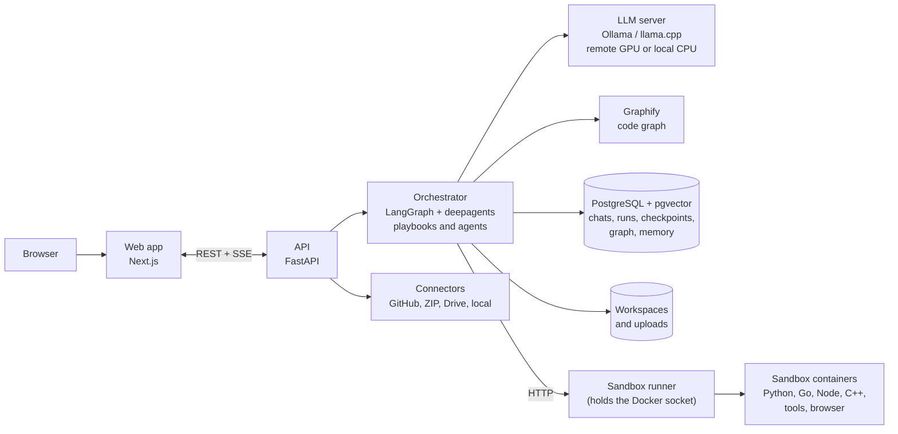

# Codewright

A self-hosted AI software house in a chat app. You chat with it like Claude or ChatGPT; behind the chat, a team of AI roles works on your code in Python, Go, TypeScript/JavaScript and C++. It can create new projects and explain, fix, test, refactor, secure, upgrade and extend existing ones. It proves its work with tests and asks for your approval before changing anything.

## Run

Requires Docker Compose.

```
make up      # build and start, then open http://localhost:3000
make down    # stop
make logs    # follow logs
```

The LLM runs on a GPU you host. See [docs/setup/remote-gpu.md](docs/setup/remote-gpu.md).

## Architecture



The API never touches the Docker socket. Only the sandbox runner does, so generated code runs in throwaway containers it controls.

## Stack

| Layer | Technology |
|---|---|
| Web app | Next.js 16, React 19, TypeScript, Tailwind CSS |
| API | Python 3.12, FastAPI, Pydantic v2, Alembic |
| Agents | LangGraph, LangChain, deepagents |
| Code understanding | Graphify |
| Storage | PostgreSQL 17 with pgvector, local disk |
| LLM | Self-hosted model through Ollama or llama.cpp |
| Sandbox | Docker, one toolchain image per language |
| Tooling | uv, pnpm, ruff, mypy, pytest, Vitest, ESLint, Prettier |
| Packaging | Docker Compose |

## Checks

```
make check           # lint, types and tests, in containers
make check-sandbox   # templates and language packs in the real sandbox (needs make up)
```

## Layout

- `apps/web`: chat UI
- `apps/api`: API
- `agent`: playbooks, agents, language packs
- `sandbox`: isolated runner for builds and tests
- `templates`: scaffolds for new projects
- `evals`: evaluation suites
- `docs`: setup, architecture, ADRs

The full design is in [CODEWRIGHT.md](CODEWRIGHT.md).
