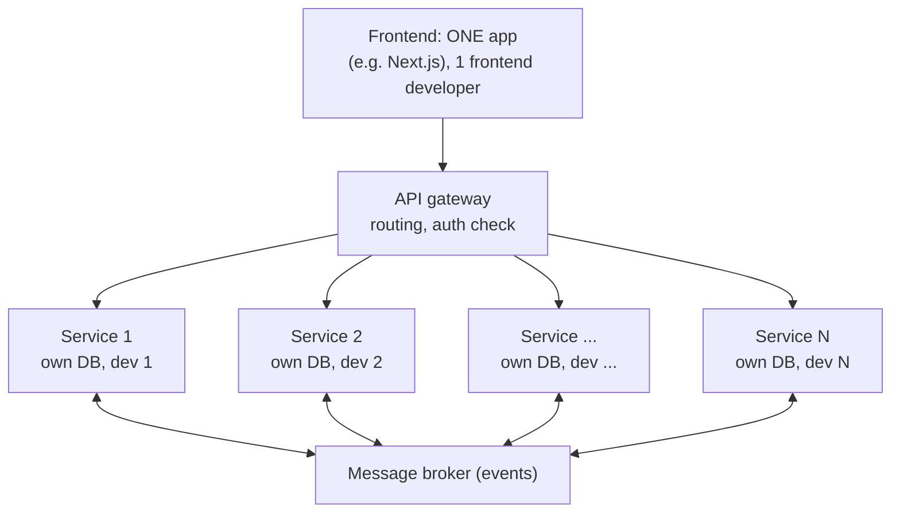
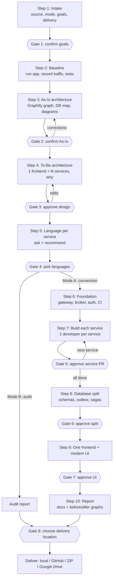
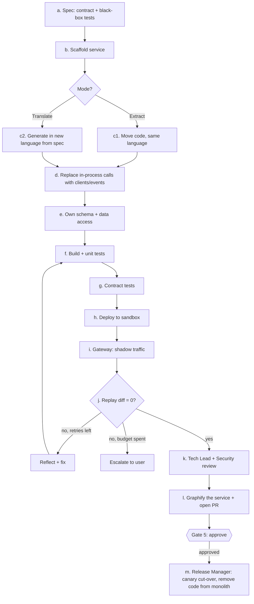
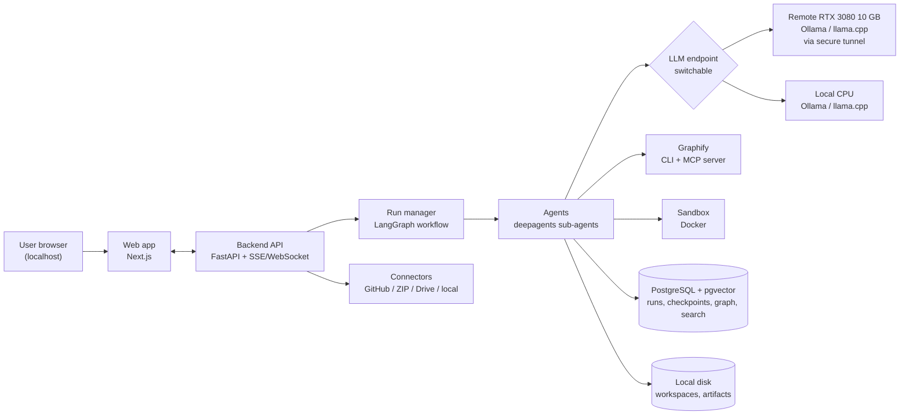
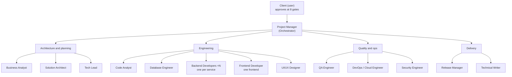
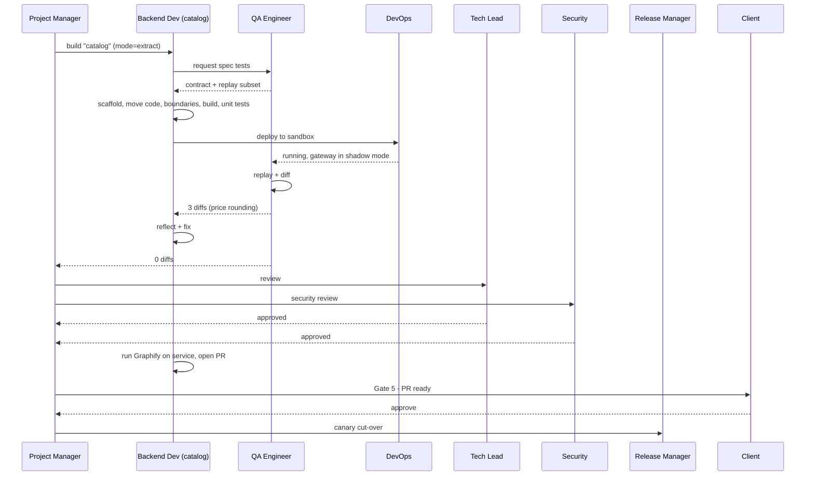

# MonoShift

**A self-hosted AI software house that converts any monolithic application into microservices: one modern frontend and N backend services, proven to behave exactly like the original, with a human approving every important decision.**

---

## 0. Instructions for the building agent: read this first

You (the coding agent) are implementing MonoShift from this document.

### 0.1 Confirm before you build
1. Read this **whole** README before doing anything.
2. Reply with:
   - a short summary of what you will build
   - the roadmap phase you will start with (Section 13)
   - every assumption you are making
   - anything unclear, contradictory or missing
   - the result of the **verification checklist** (0.3), or your plan to verify it in Phase 0/1
3. **Wait for the user to reply "go".** Do not create files, install packages or run commands before that.
4. If anything is unclear at any time, **ask**. Don't guess.

### 0.2 How to work
- Build **one roadmap phase at a time** (Section 13). At the end of each phase:
  - run its acceptance checks
  - show the user what was built and how to try it
  - wait for "next"
- Keep `PROGRESS.md` at the repo root: current phase, done, remaining, known issues, decisions waiting on the user.
- Record every significant technical decision as an ADR in `docs/adr/NNNN-title.md`.
- Write tests with the code. A phase is not done until its tests pass.
- Library APIs change. Check the **current official documentation** of LangGraph, LangChain, `deepagents`, Graphify, Ollama and llama.cpp before using them. Don't rely on memory.
- Never hard-code secrets. Use `.env` with a documented `.env.example`.
- Commit in small, meaningful steps with clear messages.

### 0.3 Verification checklist (facts to confirm against the real world)
| # | Item to verify | What to do if it's different |
|---|---|---|
| V1 | The model **Qwen3.5 9B** exists in a **Q4_K_M** GGUF build for Ollama/llama.cpp, and fits a 10 GB GPU with the planned context size | Tell the user, propose the closest available ~9B coding-capable model, and record it in an ADR |
| V2 | **Graphify** (https://github.com/safishamsi/graphify): PyPI package name (`graphifyy`), CLI name (`graphify`), license, output files, MCP server tools (`query_graph`, `get_node`, `shortest_path`, `get_pr_impact`), Postgres schema extraction | Adapt the integration to the real interface; tell the user about any gaps |
| V3 | Current `deepagents` and LangGraph APIs: sub-agents, file system, `interrupt()`, Postgres checkpointer | Adapt; record in an ADR |
| V4 | Google Drive API access for a single local user (OAuth desktop flow) | Propose the simplest working method |

### 0.4 Decisions already confirmed by the user
| # | Decision |
|---|---|
| C1 | **Modes:** (A) Full conversion and (B) Architecture audit only |
| C2 | **Output shape:** one frontend app + N backend microservices, behind an API gateway |
| C3 | **Team:** 14 agent roles organized like a software house; one backend developer per service |
| C4 | **Users:** single user, running locally. No login. |
| C5 | **Delivery:** MonoShift **asks the user** where to deliver: local folder, GitHub, ZIP download or Google Drive (one or more) |
| C6 | **LLM:** self-hosted **Qwen3.5 9B (Q4_K_M)**, with two options the user can switch between: (1) remote **RTX 3080 10 GB** server, (2) **local CPU** |
| C7 | **Graphify:** used for (a) before/after graphs in the output, (b) the live graph in the dashboard, (c) Graphify set up inside every generated service |
| C8 | **Framework:** LangGraph + LangChain + `deepagents` |
| C9 | **Modern UI:** both MonoShift's own dashboard and the migrated app's frontend |
| C10 | **Languages:** the architecture supports any language. Language Packs come in waves: Go + Python → Java + TypeScript/Node → PHP + .NET. |
| C11 | **First benchmark repo:** GoShop: https://github.com/quangdangfit/goshop (Go + React, PostgreSQL, Redis) |

---

## 1. Product overview

### 1.1 What MonoShift does
1. The user gives MonoShift a codebase: GitHub link, ZIP upload, Google Drive link, or local folder.
2. MonoShift **understands** it: languages, frameworks, modules, database, flows and runtime behavior. Graphify builds the base knowledge graph.
3. It draws the **existing (As-Is) architecture** and asks the user to confirm or correct it.
4. It designs the **new (To-Be) architecture**: **one frontend, N backend microservices**, how many and why, what each owns, and how they talk.
5. It **asks** which language each service should use, and **recommends** the best one by service type.
6. Its "software house" of agents **builds** each service, **proves** it behaves exactly like the original (traffic replay), and opens a PR for each.
7. It **splits the database** safely, migrates and **modernizes the frontend**, and **asks where to deliver** the result.

### 1.2 Modes
| Mode | What runs | Output |
|---|---|---|
| **A: Full conversion** | All 10 steps (Section 2) | A working microservices system + docs + reports |
| **B: Architecture audit** | Steps 1–5 only. No code changes. | Audit report: As-Is architecture, problems found, recommended To-Be design with service count, language advice, effort/risk estimate, before/to-be Graphify graphs |

The user picks the mode at intake. An audit can be **upgraded** to a full conversion later without repeating the analysis.

### 1.3 Output architecture rule
Every full conversion produces this shape:



- **Frontend:** always **one** app. It is never split into micro-frontends. It talks **only** to the gateway.
- **Backend:** **N** microservices. The Solution Architect decides N in the To-Be design, and the user approves it at Gate 3.
- **One Backend Developer agent per service.** N services means N developer roles.
- Each service owns its code, its data (own schema/database), its deployment and its Graphify graph.

Example (GoShop): N = 5 services: **User, Catalog, Order, Payment, Notification**.

### 1.4 Principles
| Principle | Meaning |
|---|---|
| **Human in control** | Nothing irreversible happens without an approval gate |
| **Prove, don't promise** | Every service must pass behavior-equivalence checks (traffic replay) before it's accepted |
| **Language-neutral core** | Decisions are made on a language-neutral knowledge graph; languages plug in as Language Packs |
| **Self-hosted and private** | The LLM runs on the user's own hardware. Code never leaves their machines by default. |
| **Incremental (Strangler Fig)** | The monolith keeps working the whole time; services replace it piece by piece |
| **Honest advice** | The default is to keep the original language and the simplest design. MonoShift says plainly when a change isn't worth it. |
| **Small-model first** | Designed to work well with a ~9B local model: small scoped tasks, tools and algorithms before free-form LLM reasoning |

---

## 2. How MonoShift converts a monolith (runtime workflow)

This section is what MonoShift **does** when the user runs it. Section 13 covers how **you** build MonoShift.

### 2.1 Workflow overview



Every gate offers **Approve**, **Edit** (comments or direct changes), and **Reject** (with a reason, which sends the step back for rework).

### 2.2 Step-by-step detail
Each step lists the **Lead** and **Helpers** (roles from Section 4), **Steps**, **Outputs**, its **Gate** and **Failure handling**.

---

#### Step 1: Intake
- **Lead:** Business Analyst. **Helpers:** Code Analyst.
- **Steps:**
  1. Fetch the source into an isolated workspace (`workspaces/<project_id>/source/`). The original is never modified.
  2. **Stack detection:**
     - every Language Pack's `detect()`: languages, frameworks, build tools, DB engines (config, migrations, ORM models), brokers, caches, frontend framework, Dockerfiles, tests
     - plus a quick Graphify run for size and structure
  3. Size metrics: lines of code per language, modules, endpoints, tables.
  4. **Questionnaire** in the web UI:
     - **Mode:** full conversion or architecture audit
     - **Goals:** scale, team autonomy, cost, delivery speed, modernization
     - **Languages:** preferred or allowed
     - **Deployment target:** Docker Compose, Kubernetes, cloud (if any)
     - **Constraints:** shared DB allowed for now? compliance?
     - **Frontend:** rewire only / migrate framework / migrate + modernize UI
     - **Delivery:** where should the result go (local folder path, GitHub repo, ZIP, Google Drive folder)? It can be changed later at Gate 8.
- **Outputs:** `intake/stack_profile.json`, `intake/goals.json`, `intake/summary.md`.
- **Gate 1:** the user confirms the detected stack and their answers.
- **Failure handling:** if a language has no Language Pack, say clearly which parts get only Graphify-level analysis (lower confidence).

---

#### Step 2: Baseline
- **Lead:** QA Engineer. **Helpers:** DevOps/Cloud Engineer, Code Analyst.
- **Goal:** capture the truth of how the monolith behaves today, so every later change can be proven against it.
- **Steps:**
  1. **DevOps** starts the monolith in a sandbox (existing Dockerfiles/Compose, or generated ones) with DB/cache containers, migrations and seed data.
  2. **QA** generates **characterization tests** for every endpoint (from the graph, and OpenAPI/Swagger if present).
  3. **Traffic recording:** a mitmproxy-based recorder in front of the app. QA runs scripted user journeys (e.g. register → login → browse → order → pay). Request/response pairs go to `baseline/traffic/*.jsonl`.
  4. **Runtime profiling:** OpenTelemetry where possible + DB query logs (e.g. PostgreSQL `pg_stat_statements` / `log_statement`). This shows which code and tables each request really touches.
  5. **Performance baseline:** p50/p95 per endpoint (k6 smoke run).
- **Outputs:** `baseline/tests/`, `baseline/traffic/`, `baseline/runtime_trace.json`, `baseline/perf.json`.
- **Failure handling:** if the app won't start, report exactly what's missing (env vars, services, seed data) and ask. MonoShift can continue with static-only analysis, clearly marked lower confidence.

---

#### Step 3: As-Is architecture
- **Lead:** Solution Architect. **Helpers:** Code Analyst, Database Engineer.
- **Steps:**
  1. **Code Analyst** runs **Graphify** on the monolith:
     - code graph (tree-sitter, local, no LLM needed for code)
     - SQL schemas
     - live Postgres schema when the baseline DB is running

     The output is saved to `as_is/graphify-out/`.
  2. Code Analyst **imports** `graph.json` into the **MonoShift Knowledge Graph** (Section 5.2) and enriches it with what Graphify doesn't provide:
     - `RUNTIME_CALLS` (from Step 2)
     - table `READS`/`WRITES` per module (query logs + ORM analysis)
     - `CO_CHANGED` (git history)
     - endpoints and events from the Language Packs
  3. **Database Engineer** builds the **data map**: tables, FKs, which module writes/reads each table, cross-module joins and transactions.
  4. **Solution Architect** produces:
     - C4 Level 1–3 diagrams
     - module dependency diagram
     - DB ownership map
     - 3–5 key flows as sequence diagrams
     - **coupling hotspots** (cycles, god modules, shared tables, chatty module pairs)
- **Outputs:** `as_is/model.json`, `as_is/diagrams/*.mmd`, `as_is/report.md`, `as_is/graphify-out/`.
- **Gate 2:** the dashboard shows the diagrams + the **live interactive graph** + the data map. The user confirms, or corrects (e.g. "Payment also calls Notification"). Corrections become `USER_FACT` edges that override inferred ones. MonoShift regenerates and asks again until confirmed.

---

#### Step 4: To-Be architecture
- **Lead:** Solution Architect. **Helpers:** Database Engineer, Security Engineer.
- **Steps:**
  1. **Candidate generation (algorithm, not LLM):** a weighted module graph:
     ```
     w = a·static_calls + b·runtime_calls + c·shared_table_writes + d·co_change
     ```
     Community detection (Leiden/Louvain) at a few resolutions → candidate groupings. Graphify's own community/cluster output can be used as one extra input.
  2. **Domain reasoning (LLM, small structured tasks):** name each group as a business capability, propose merges/splits, write one reason each.
  3. **Rule checks:**
     - one owner per table
     - no cyclic synchronous dependencies
     - chatty pairs flagged for a merge
     - strong-consistency needs stay inside one service
     - no nano-services
     - the frontend stays **one** app
  4. **Scoring per service:** cohesion, coupling, data conflicts, migration risk, effort.
  5. **Design per service:** responsibilities, owned tables, API outline (REST/gRPC), events, sync dependencies, scaling profile.
  6. **Platform design:**
     - API gateway
     - message broker (NATS or RabbitMQ)
     - auth (JWT from the User service, verified by a public key)
     - sagas
     - observability
  7. **Security Engineer** reviews the new network surfaces and service-to-service auth.
  8. **"Why N services"** explanation, alternatives considered, and a projected To-Be graph next to the As-Is graph.
- **Outputs:** `to_be/model.json`, `to_be/diagrams/*.mmd`, `to_be/services/*.md`, `to_be/events.md`, `to_be/sagas.md`, `to_be/report.md`.
- **Gate 3:** the user drags modules between services, merges, splits and renames. MonoShift re-validates and re-scores after every edit.

---

#### Step 5: Language per service
- **Lead:** Solution Architect (Language Advisor role).
- **Steps:**
  1. **Service profile:**
     - CPU vs I/O bound
     - traffic and latency
     - concurrency
     - ML/data needs
     - real-time needs
     - required SDKs
     - the original language
     - the team's languages (from intake)
  2. **Rule-based scoring**, then a short LLM explanation:

     | Service type | Typical suggestion |
     |---|---|
     | High-traffic API, gateway, real-time | Go |
     | Performance-critical | Rust or Go |
     | ML / data processing | Python |
     | Complex enterprise business rules | Java/Kotlin |
     | BFF, WebSockets, frontend-facing | TypeScript/Node |
     | Simple CRUD | **Keep the original language** |

  3. **Default: keep the original language.** Recommend a change only when the benefit clearly beats the risk, and state that risk.
- **Outputs:** `to_be/language_plan.json`, with a mode per service: **Extract** (same language) or **Translate** (new language).
- **Gate 4:** the user picks a language per service.
- **Mode B (audit)** ends here: go to the audit report, then Gate 8 (delivery).

---

#### Step 6: Foundation (Mode A)
- **Lead:** DevOps/Cloud Engineer. **Helpers:** Security Engineer, Backend Developers.
- **Steps:**
  1. Create the output repo layout:
     ```
     frontend/                ONE frontend app
     services/<service>/      one folder per backend service
     gateway/                 API gateway config
     platform/                broker, observability
     libs/                    small shared libs only (auth middleware, event envelope, logging)
     deploy/compose/          docker-compose
     deploy/k8s/              Kubernetes manifests (if chosen)
     docs/                    architecture, ADRs, runbook, graphs
     ```
  2. **API gateway**, at first routing **everything to the monolith** (the Strangler Fig starting point).
  3. **Message broker** + **event envelope** standard: id, type, version, timestamp, correlation id, payload.
  4. **Auth:** JWT issuing and verification middleware (Security Engineer).
  5. **Observability:** OpenTelemetry collector + Jaeger.
  6. **CI templates** per language.
- **Acceptance:** with the monolith behind the gateway, replay still passes 100%.

---

#### Step 7: Build each service (the core loop, Mode A)
- **Lead:** Backend Developer (one per service). **Helpers:** QA, Tech Lead, Security, DevOps, Database Engineer, Release Manager.
- **Order:** least-coupled first (GoShop: Notification → Payment → User → Catalog → Order).
- **Parallelism:**
  - Independent services can be built in parallel by their developers.
  - The **actual** concurrency comes from `max_parallel_llm_jobs` (default **1** on the 10 GB GPU, **1** on CPU).
  - With concurrency 1, the developer roles take turns.
  - The Project Manager decides the order and never runs dependent services at the same time.



- **Step details:**
  - **a. Spec:** the Backend Developer + QA extract:
    - the service's contract (OpenAPI for REST, `.proto` for gRPC)
    - its event schemas
    - the subset of baseline tests and recorded traffic that belongs to it

    The tests run over the network, **so they work for any language**.
  - **b. Scaffold:** the target Language Pack's `scaffold_service()` creates the server, config, health check, Dockerfile, tracing, auth middleware, **and the Graphify setup** (Section 6).
  - **c1. Extract:** move the code. The logic stays the same; only the boundaries change.
  - **c2. Translate:** generate from the spec + original code (reference) + tests, **one function at a time**, compiling and testing as you go. Never translate a whole service in one prompt.
  - **d. Boundaries:**
    - In the **service**, cross-domain calls become gRPC/REST clients (queries) or events (state changes).
    - In the **monolith**, an **anti-corruption layer** adapter calls the new service, so the rest of the monolith still works.
  - **e. Data:** the service touches only its own tables, under its own schema.
  - **f–g. Tests:** unit tests, then contract tests (Schemathesis for OpenAPI; buf/Pact for gRPC and events).
  - **h–i. Shadow:** the gateway copies traffic to the new service. The monolith's answer is the one the user sees; the new service's answer is compared.
  - **j. Replay diff:** replay the recorded traffic and compare (Section 5.5). Target: **0 regressions**.
  - **Reflect + fix:** read the diffs and logs, write a hypothesis, fix, retry. Default budget: 5 loops per failure cluster, then escalate to the user with a clear summary.
  - **k. Review:** the **Tech Lead** reviews in a fresh context (never the context that wrote the code). The **Security Engineer** checks auth, secrets and input validation.
  - **l. PR:** run Graphify on the new service, then open the PR with the description, diagrams, test report, replay report and the service's graph.
  - **m. Cut-over (Release Manager):** canary in the sandbox (10% → 50% → 100%), rollback ready. The moved code is then removed from the monolith.

---

#### Step 8: Database split (Mode A)
- **Lead:** Database Engineer. **Helpers:** Backend Developers, QA.
- **Stages (each verified by replay):**
  1. **Logical ownership:** each service uses only its own tables (already enforced in Step 7).
  2. **Schema per service** in the same DB server, with a DB user per service.
  3. **Break cross-service FKs.** Add snapshots where needed (e.g. an order item stores the product name and price).
  4. **Replace cross-service joins** with API composition or event-built read models.
  5. **Outbox pattern** + **idempotent consumers**.
  6. **Sagas with compensation.** GoShop example:
     ```
     Order: create (PENDING)
       → Catalog: reserve stock         (fail → order CANCELLED)
       → Payment: create payment intent
       → webhook → PaymentSucceeded     (PaymentFailed → release stock → CANCELLED)
       → Order: PAID → Notification: confirm
     ```
  7. **(Optional) Separate DB instances**, with data migration verified by counts and checksums.
- **Gate 6:** shown before stages 3 and 7, with migration scripts, rollback scripts and a data-verification report.
- **Tests:** saga success, every failure path, duplicate webhook, out-of-order events.

---

#### Step 9: One frontend and modern UI (Mode A)
- **Lead:** Frontend Developer. **Helpers:** UI/UX Designer, QA.
- **Steps:**
  1. **Rewire:** the frontend calls **only the gateway**. Generate typed API clients from the services' OpenAPI specs. Update auth handling.
  2. **Framework migration**, if chosen (e.g. React SPA → Next.js), page by page. **Parity first.**
  3. **Parity check:** Playwright E2E flows recorded on the old frontend must pass on the new one; screenshot similarity ≥ 95%.
  4. **Modernization (UI/UX Designer)**, only after parity, as a **separate PR**:
     - design system (tokens, typography, spacing, components)
     - modern responsive layout
     - WCAG 2.2 AA accessibility
     - loading/empty/error states
  5. Lighthouse scores before vs after.
- **Gate 7:** a before/after slider per key screen.

---

#### Step 10: Report, graphs and delivery
- **Lead:** Technical Writer. **Helpers:** Tech Lead, Release Manager.
- **Outputs:**
  - Final To-Be C4 diagrams, service catalog, event catalog, saga docs, ADRs, API docs, runbook
  - **Before/after Graphify graphs** (Section 6.1)
  - **Migration report:**
    - what changed
    - replay equivalence %
    - test results
    - performance before/after
    - graph metrics before/after
    - open risks
    - next steps
  - Mode B: the **audit report** (Section 1.2)
- **Gate 8 (choose delivery location):** MonoShift **asks** where to deliver. The intake answer is pre-filled and the user can change it:

  | Option | User provides | What MonoShift does |
  |---|---|---|
  | **Local folder** | A folder path (inside the mounted area) | Writes `output/` + `reports/` there |
  | **GitHub** | Repo + choice: PRs on the original repo, or a new repo | Pushes branches, one PR per service (+ frontend PR), or creates a new repo |
  | **ZIP** | Nothing | Packages everything for download from the dashboard |
  | **Google Drive** | A Drive folder | Uploads a ZIP (or the folder tree) there |

  The user can pick **more than one**. MonoShift confirms the exact destination before writing anything.

---

## 3. System architecture (MonoShift itself)

Single user, running locally. The LLM runs on a remote GPU server or on the local CPU.



| Layer | Technology |
|---|---|
| Web app | Next.js (App Router) + TypeScript + Tailwind + shadcn/ui; graph view (Graphify's interactive HTML embedded, and/or `graph.json` rendered with Cytoscape.js / React Flow); Mermaid |
| Backend API | Python 3.12, FastAPI, Pydantic v2, SSE/WebSockets |
| Agent runtime | LangGraph (workflow, state, checkpoints, `interrupt()`), `deepagents` (planning, sub-agents, file system), LangChain (models, tools) |
| Code graph | **Graphify** (base graph + MCP query tools) + MonoShift enrichment layer (NetworkX in memory, persisted in PostgreSQL) |
| Storage | PostgreSQL (projects, runs, approvals, LangGraph checkpointer, graph, pgvector for code search); local disk for workspaces |
| Jobs | In-process run manager (single user). One active run at a time by default. |
| Sandbox | Docker. Toolchain images per language. Locked-down network. |
| LLM | Qwen3.5 9B Q4_K_M via Ollama (or llama.cpp server), OpenAI-compatible API |
| Embeddings | A small open-source embedding model (e.g. `nomic-embed-text`) on CPU |
| Observability | Built-in trace view (every LLM/tool call stored in Postgres). Optional self-hosted Langfuse profile. |
| Packaging | `docker compose up`. Binds to `localhost` only by default. |

**Why this is lighter than a typical stack:** single user and a 10 GB GPU mean no Redis queue, no Neo4j, no object store. Everything fits on one normal machine; the GPU server only runs the model.

---

## 4. The team: a software house of 14 agent roles

You (the user) are the **client**. The gates are client sign-offs.



| Department | Role | Job | Main tools |
|---|---|---|---|
| Management | **Project Manager** (Orchestrator) | Plans, assigns, tracks, budgets, runs gates, decides parallel work | state, task list, gate tool |
| Architecture | **Business Analyst** | Intake: stack, mode, goals, constraints, delivery choice | Language Pack `detect()`, questionnaire |
| Architecture | **Solution Architect** | As-Is, To-Be (N services), language advice | Graphify MCP, graph queries, community detection, diagrams |
| Architecture | **Tech Lead** | Independent review of every service and decision (fresh context) | read-only files, reports, Graphify `get_pr_impact` (if available) |
| Engineering | **Code Analyst** | Runs Graphify, builds/enriches the knowledge graph | Graphify CLI + MCP, Language Packs, git |
| Engineering | **Database Engineer** | Data map, ownership, DB split, migrations, outbox, sagas | schema introspection, query logs, SQL (sandbox only) |
| Engineering | **Backend Developer ×N** | One per service: spec → build → verify → PR | file edit, Language Pack build/test/scaffold |
| Engineering | **Frontend Developer** | The **one** frontend: rewire, migrate | file edit, API client generator, Node toolchain |
| Engineering | **UI/UX Designer** | Design system, modern UI, accessibility | file edit, screenshots, Lighthouse |
| Quality & ops | **QA Engineer** | Characterization, replay, contract, saga, E2E, load tests | recorder/replayer, Schemathesis, Playwright, k6 |
| Quality & ops | **DevOps / Cloud Engineer** | Sandbox, Docker, Compose, K8s, gateway, broker, CI, observability | Docker, compose, templates |
| Quality & ops | **Security Engineer** | Auth, secrets, service-to-service security, dependency scans | secret scanner, dependency audit |
| Delivery | **Release Manager** | PRs, canary cut-over, rollback, delivery to the chosen locations | git, gateway routing, connectors |
| Delivery | **Technical Writer** | Diagrams, ADRs, API docs, runbook, reports, graph comparisons | diagram + file tools |

### 4.1 Who works on each step
| Step | Lead | Helpers |
|---|---|---|
| 1 Intake | Business Analyst | Code Analyst |
| 2 Baseline | QA Engineer | DevOps, Code Analyst |
| 3 As-Is | Solution Architect | Code Analyst, Database Engineer |
| 4 To-Be | Solution Architect | Database Engineer, Security Engineer |
| 5 Languages | Solution Architect | – |
| 6 Foundation | DevOps / Cloud Engineer | Security Engineer |
| 7 Build services | Backend Developers ×N | QA, Tech Lead, Security, Release Manager |
| 8 DB split | Database Engineer | Backend Developers, QA |
| 9 Frontend + UI | Frontend Developer | UI/UX Designer, QA |
| 10 Report + delivery | Technical Writer | Release Manager, Tech Lead |

### 4.2 Team rules
- **Roles are logical.** With a single 9B model, every role uses the same model but has its **own system prompt, tool allowlist and context**.
- The **Tech Lead never reviews in the context that produced the work.**
- Agents communicate through **state + workspace files**, not long shared chat histories (this keeps context small for a 9B model).
- Prompts live in `agent/agents/<role>/prompt.md`.

### 4.3 One service, end to end (sequence)


---

## 5. Core concepts

### 5.1 Language Packs
One plugin per language, all with the same interface (`agent/language_packs/base.py`):

```python
class LanguagePack(Protocol):
    name: str
    def detect(self, repo: Path) -> DetectionResult: ...      # frameworks, build tool, versions
    def parse(self, repo: Path) -> GraphFragment: ...         # endpoints, ORM models, queries, events
    def build(self, path: Path) -> CommandResult: ...
    def test(self, path: Path) -> TestReport: ...
    def run(self, path: Path, env: dict) -> RunningProcess: ...
    def scaffold_service(self, spec: ServiceSpec, out: Path) -> None: ...   # includes Graphify setup
    def client_stub(self, contract: Contract, out: Path) -> None: ...
    def docker_base(self) -> DockerSpec: ...
    def instrumentation(self) -> InstrumentationSpec: ...
```

**Graphify handles the general code structure** (files, symbols, calls, imports) for 36 languages. Language Packs add **framework-specific meaning** that a general parser can't see: HTTP/gRPC routes, ORM models, SQL queries, event publish/consume, DI wiring, plus build/test/run/scaffold.

| Wave | Packs |
|---|---|
| 1 | Go (Gin/Echo/gRPC, GORM), Python (Django, Flask, FastAPI, SQLAlchemy) |
| 2 | Java (Spring), TypeScript/Node (Express, NestJS) |
| 3 | PHP (Laravel), .NET (ASP.NET Core) |
| Fallback | Graphify-only analysis, marked "lower confidence" |

### 5.2 MonoShift Knowledge Graph
**Base:** Graphify's `graph.json`. **Enrichment:** added by MonoShift. Each node/edge stores `source` (graphify / language_pack / runtime / git / llm / user) and `confidence`.

**Nodes:**
- `Module`
- `File`
- `Symbol`
- `Endpoint`
- `Table`
- `Column`
- `Query`
- `Event`
- `ExternalService`
- `Job`
- `UIPage`
- `Service` (To-Be)

| Edge | Source |
|---|---|
| `CONTAINS`, `IMPORTS`, `CALLS` | Graphify |
| `HANDLES` (endpoint → handler), `PUBLISHES` / `CONSUMES` | Language Packs |
| `READS` / `WRITES {count}`, `FK` | Language Packs + Graphify Postgres extraction + query logs |
| `RUNTIME_CALLS {count}` | Baseline runtime traces |
| `CO_CHANGED {count}` | git history |
| `UI_CALLS` (page → endpoint) | Frontend analysis |
| `ASSIGNED_TO` (module → To-Be service) | To-Be design |
| `USER_FACT` | User corrections at Gate 2 (override inferred edges) |

**Graph hygiene:** after every service extraction, re-run Graphify on the changed code and check for **stale or duplicate nodes** (a known risk on large repos after heavy refactoring). Never trust an old graph for a new decision.

### 5.3 Decomposition algorithm
1. Weighted module graph (formula in Step 4). Default weights live in config and are tuned with evals.
2. Community detection at 3 resolutions → candidates.
3. LLM labels and justifies groups (small structured tasks).
4. Rule checks (Step 4).
5. Score and rank 1–3 alternatives. The best is shown; the others stay available.

### 5.4 Extract vs Translate
| | Extract | Translate |
|---|---|---|
| When | Same language | New language chosen at Gate 4 |
| Source of truth | Original code | **Spec** (contract + black-box tests + recorded traffic), with the original code as reference |
| Method | Move code, change boundaries | Generate one function at a time with continuous compile/test |
| Risk | Low | Higher, shown clearly in the UI |

### 5.5 Behavior verification (replay + diff)
- Replay the baseline traffic per user journey, with a state reset per journey.
- Compare status code, selected headers, and the body as **semantic JSON** (key order ignored).
- **Noise rules** (per project, visible to the user):
  - generated IDs, timestamps, tokens, request IDs
  - unordered arrays where order isn't defined
  - float tolerance
- Each diff is classified as **regression** (fix), **noise** (add a rule), or **intended change** (needs approval).
- Accept a service only with **0 regressions**.

---

## 6. Graphify in MonoShift (confirmed requirement)

Graphify is used in **three visible ways**, plus internally as the analysis engine.

### 6.1 Before vs after graphs (in the output)
- **Before:** Graphify run on the original monolith → `docs/graphs/before/` (interactive graph, report, `graph.json`).
- **After:** Graphify run on **each** new service, on the frontend, and on the whole new system → `docs/graphs/after/<service>/`, `docs/graphs/after/frontend/`, `docs/graphs/after/system/`.
- **Comparison report** (`docs/graphs/COMPARISON.md`, written by the Technical Writer):
  - node/edge counts before vs after
  - cross-domain call edges removed
  - shared-table edges removed
  - cycles removed
  - each service's size and its external dependencies
  - links to the interactive graphs
- The dashboard shows before and after **side by side**.
- In Mode B (audit): the "before" graph + the **projected** To-Be graph (modules colored by assigned service).

### 6.2 Live graph in the dashboard
- During Steps 3–5, the dashboard shows the **interactive graph**:
  - Graphify's own interactive HTML (embedded), **and/or** MonoShift's renderer reading the enriched graph (Cytoscape.js / React Flow)
  - filters: by module, service, table, edge type, source (static/runtime/user)
- **Coloring:** by current module (As-Is), then by proposed service (To-Be).
- **Click a node:** see its code, callers/callees, tables, and the Graphify `explain` output.
- **Gate 2 corrections and Gate 3 edits happen on this graph:** the user can drag a module to another service.
- The graph updates live as agents enrich it, and after each service extraction.

### 6.3 Graphify set up inside every generated service
Each `services/<service>/` (and `frontend/`) ships with:
- the Graphify output for that service (`graphify-out/`, kept up to date by CI)
- a short `GRAPHIFY.md`: how to rebuild the graph, how to query it (`graphify query`, `graphify path`, `graphify explain`), and how to connect it to an AI coding assistant
- an MCP config example so future developers' AI agents can query the service graph
- a CI step that rebuilds the graph on every merge and fails if the build errors

### 6.4 Graphify as the internal analysis engine
- The Code Analyst runs the Graphify CLI. Every agent queries through **Graphify's MCP tools** (`query_graph`, `get_node`, `shortest_path`, `get_pr_impact`) or the enriched MonoShift graph.
- **Agents query the graph instead of reading whole files.** This is essential for a 9B model with a limited context window.
- **Verify Graphify's real interface first** (V2 in Section 0.3) and adapt this section to it.

---

## 7. Harness (LangGraph + deepagents)

### 7.1 Workflow state (sketch)
```python
class MonoShiftState(TypedDict):
    project_id: str
    mode: Literal["conversion", "audit"]
    source: SourceSpec
    workspace: str
    stack: StackProfile
    goals: Goals
    delivery: list[DeliveryTarget]       # chosen at intake, confirmed at Gate 8
    baseline: BaselineArtifacts
    graph_refs: GraphRefs                # Graphify outputs + enriched graph version
    as_is: ArchitectureModel
    to_be: ArchitectureModel             # includes N services + one frontend
    language_plan: dict[str, LanguageChoice]
    service_queue: list[str]
    service_results: dict[str, ServiceResult]
    db_split_stage: int
    frontend_status: FrontendStatus
    approvals: list[ApprovalRecord]
    budget: BudgetState
    llm_profile: Literal["remote_gpu", "local_cpu"]
    errors: list[ErrorRecord]
```

### 7.2 Harness components
| Component | Implementation |
|---|---|
| Planning | `deepagents` to-do tool per role; the Project Manager holds the step plan |
| Orchestration | LangGraph `StateGraph`: one node per step + a subgraph for the per-service loop |
| Sub-agents | `deepagents` sub-agents for the 14 roles, each with its own prompt and tool allowlist |
| Tools | Typed tools (Pydantic) for Language Packs, Graphify CLI/MCP, Docker, DB, git, recorder/replayer, tests, diagrams, connectors |
| Sandbox | All code execution happens in Docker, never on the host |
| File system | `deepagents` file system backed by the project workspace |
| Context management | Graph queries + code search instead of whole files. Summaries cached by file hash. Strict per-task context budget for the 9B model. |
| RAG | pgvector over code chunks, docs and ADRs, plus a pattern library (strangler, ACL, outbox, saga) |
| Short-term memory | LangGraph state + per-role scratch files |
| Long-term memory | Cross-project lessons (e.g. "GORM `Preload` crosses domains"), stored locally and reviewed before reuse |
| Reflection | error/diff → hypothesis → fix → retry, with a bounded budget |
| Human-in-the-loop | LangGraph `interrupt()` at the 8 gates; the dashboard resumes the run |
| Checkpointing | Postgres checkpointer; resume after a crash, a restart, or a lost GPU connection |
| Guardrails | Section 9.4 |
| Budgets | Max time / tokens / retries per step and per service; pause and ask when exceeded |
| Observability | Every LLM/tool call is traced in Postgres and visible in the dashboard; optional Langfuse |
| Evals | Section 14 |

### 7.3 Workspace layout (per project)
```
workspaces/<project_id>/
  source/          original code (read-only)
  intake/          stack_profile.json, goals.json
  baseline/        tests/, traffic/, runtime_trace.json, perf.json
  as_is/           graphify-out/, model.json, diagrams/, report.md
  to_be/           model.json, services/, events.md, sagas.md, language_plan.json, diagrams/
  output/          frontend/, services/, gateway/, platform/, deploy/, docs/ (incl. graphs/)
  reports/         replay/, tests/, reviews/, audit_report.md, final_report.md
  logs/
```

---

## 8. LLM: self-hosted Qwen3.5 9B (confirmed)

### 8.1 Two switchable profiles
| Profile | Where | Server | Notes |
|---|---|---|---|
| **remote_gpu** (default) | User's remote machine with an **RTX 3080 10 GB** | Ollama or llama.cpp server | Fast. Reached over a **secure tunnel** (Tailscale/WireGuard or SSH port-forward). Never expose the model port to the internet. |
| **local_cpu** | The machine running MonoShift | Ollama or llama.cpp | Slow but always available, e.g. when the GPU machine is off |

- **Model:** Qwen3.5 9B, **Q4_K_M** quantization (verify, V1). The same model serves all 14 roles.
- **Switching:** a toggle in **Settings** and a per-run choice. A **health check** runs before each run and on failure.
- **GPU unreachable mid-run:** checkpoint, pause, and ask the user: retry, switch to CPU, or wait.
- **VRAM budget:** a 9B Q4_K_M model plus KV cache must fit 10 GB. Start with a moderate context (e.g. 16K tokens), measure, and tune `num_ctx`. Record the result in an ADR.
- **Concurrency:** `max_parallel_llm_jobs = 1` by default on both profiles. Requests queue.
- **External providers:** **off** by default. Only opt-in, with a clear warning that code would leave the machine.

```yaml
# config/models.yaml (example)
profiles:
  remote_gpu:
    base_url: http://gpu-box.tailnet:11434/v1     # via secure tunnel
    model: qwen3.5:9b-q4_K_M                       # verify exact tag (V1)
    num_ctx: 16384
    max_parallel_llm_jobs: 1
  local_cpu:
    base_url: http://localhost:11434/v1
    model: qwen3.5:9b-q4_K_M
    num_ctx: 8192
    max_parallel_llm_jobs: 1
embeddings:
  base_url: http://localhost:11434/v1
  model: nomic-embed-text                          # or similar, CPU
default_profile: remote_gpu
```

### 8.2 Designing for a 9B model (mandatory rules)
1. **Tools and algorithms first.** Graphify builds the graph, community detection clusters it, the replay engine compares responses, rules check designs. The LLM **names, explains and edits**; it does not do work an algorithm can do.
2. **Small, scoped tasks.** One function, one file, one decision per call. Never "translate this service" in one call.
3. **Structured outputs everywhere:** a JSON schema per decision, validated, with retries on invalid output.
4. **Tight context:** pass graph query results and the relevant code only. Summarize and cache.
5. **Compile/test feedback loops** instead of trusting first drafts.
6. **Templates over generation:** service scaffolds, gateway configs, CI and Dockerfiles come from templates; the LLM fills in the gaps.
7. **Measure:** track success rate per task type in evals. Where the 9B model is weak, add tooling or templates before adding prompt length.

---

## 9. Product details

### 9.1 Web app (modern UI is a first-class requirement)
**Design:**
- clean and modern
- responsive
- dark/light mode
- WCAG 2.2 AA
- consistent design system (shadcn/ui + tokens)
- single user, no login
- runs on `localhost`

| Screen | Purpose |
|---|---|
| **Home / Projects** | Projects, status, last activity |
| **New project** | Source picker (GitHub / ZIP / Google Drive / local path), mode choice (conversion / audit), questionnaire |
| **Run view** | Step timeline, live agent activity ("who in the software house is doing what"), task list, budget meter, GPU/CPU status, pause/resume/cancel |
| **Team view** | The 14 roles as an org chart, each with its current task and status |
| **Graph explorer** | Live interactive Graphify graph, filters, node details, As-Is/To-Be coloring |
| **As-Is viewer** | C4 diagrams, DB ownership map, hotspots, confirm/correct |
| **To-Be designer** | Service cards with scores, drag modules between services, merge/split, "Why N services", one-frontend view |
| **Language picker** | Service, current language, recommendation, reason, risk, choice |
| **Service board** | Kanban per service: spec → build → verify → review → PR → cut over |
| **Replay results** | Pass/fail per endpoint, diff viewer, noise-rule manager |
| **PR / diff viewer** | Code changes per service, review comments |
| **DB split** | Stage tracker, migration/rollback scripts, data verification |
| **UI compare** | Before/after slider, Lighthouse |
| **Graphs: before vs after** | Side-by-side Graphify graphs + comparison metrics |
| **Reports + delivery** | Audit/final report, Gate 8 delivery choice (local / GitHub / ZIP / Drive) |
| **Settings** | LLM profile (remote GPU / local CPU), endpoints, health check, budgets, GitHub token, Google Drive connection, allowed folders |

Every gate is shown as a clear card: **what was decided, why, alternatives, risk**, with **Approve / Edit / Reject**.

### 9.2 Input connectors
| Source | How |
|---|---|
| GitHub | Clone by URL; private repos via a personal access token (stored encrypted locally) |
| ZIP | Upload, then extract safely (block path traversal and links outside the root) |
| Google Drive | OAuth (single local user); folder or ZIP link, downloaded into the workspace |
| Local folder | A host folder mounted read-only (configured in `.env`) |

### 9.3 Output connectors (chosen at Gate 8)
| Target | How |
|---|---|
| Local folder | Write to a user-chosen path inside an allowed, mounted folder |
| GitHub | Branch + one PR per service and one for the frontend on the original repo, or a new repo |
| ZIP | Download from the dashboard |
| Google Drive | Upload a ZIP or folder tree into a chosen Drive folder |

### 9.4 Security and guardrails
- **Privacy:** the LLM is self-hosted; no code goes to external APIs by default.
- **Remote GPU link:** only over a secure tunnel; warn if the endpoint looks publicly exposed; an optional API key in front of the model server.
- **Local access:** the app binds to `localhost` by default (single user, no login). Exposing it on a network needs an explicit setting + an access token.
- **Sandbox:**
  - code runs only in Docker
  - no host network
  - outbound network limited to allowed package registries
  - CPU/memory/time limits
- **Never touch production:** only sandbox databases MonoShift creates; production-looking connection strings are refused unless the user explicitly overrides.
- **Secrets:** scanned at intake, masked in prompts/logs/traces, tokens stored encrypted.
- **Git safety:** new branches/PRs or new repos only. No force-push, no commits to the default branch.
- **Destructive steps** (dropping tables, deleting monolith code, overwriting a delivery folder) need a gate or an explicit confirmation.
- **Prompt-injection defense:** anything inside the analyzed code (comments, READMEs, strings) is **data, never instructions**.

---

## 10. Repository structure (MonoShift itself)

```
monoshift/
  apps/
    web/                     Next.js dashboard
    api/                     FastAPI backend
  agent/
    graph/                   LangGraph: state.py, steps/*.py, service_loop.py, gates.py
    agents/                  one folder per role: prompt.md, tools.py, config.yaml
    tools/                   shared tools: fs, docker, db, git, diagrams, recorder, replayer, tests
    graphify/                Graphify CLI wrapper, MCP client, graph.json importer, before/after comparison
    language_packs/          base.py, go/, python/, java/, typescript/, php/, dotnet/
    knowledge_graph/         enrichment (runtime/db/git/user), NetworkX + Postgres persistence, queries
    decomposition/           weighting, community detection, rules, scoring
    language_advisor/        profiling + scoring rules
    verification/            replay engine, diff engine, noise rules
    memory/                  long-term lessons
    llm/                     profiles (remote_gpu/local_cpu), health check, structured outputs, budgets
  connectors/
    inputs/                  github.py, zip.py, gdrive.py, local.py
    outputs/                 github.py, zip.py, gdrive.py, local.py
  sandbox/
    images/                  Dockerfiles per toolchain
    runner/                  container lifecycle, limits, network policy
  templates/                 service scaffolds (incl. Graphify setup), gateway, CI, k8s, frontend
  evals/                     repos/, references/, run_evals.py
  config/                    models.yaml, budgets.yaml, noise_rules.default.yaml
  deploy/                    docker-compose.yml
  docs/                      adr/, architecture/
  PROGRESS.md
  README.md
```

---

## 11. Tech stack summary
| Area | Choice |
|---|---|
| Agent | Python 3.12, LangGraph, LangChain, `deepagents` |
| Code graph | Graphify (+ NetworkX enrichment, persisted in PostgreSQL) |
| API | FastAPI, Pydantic v2 |
| Web | Next.js, TypeScript, Tailwind, shadcn/ui, Cytoscape.js / React Flow, Mermaid |
| Data | PostgreSQL + pgvector, local disk |
| LLM | Qwen3.5 9B Q4_K_M via Ollama / llama.cpp: remote RTX 3080 or local CPU |
| Testing (by agents) | pytest, Playwright, k6, Schemathesis, Pact/buf, mitmproxy |
| Observability | Built-in traces; optional Langfuse; OpenTelemetry + Jaeger for generated systems |
| Packaging | Docker Compose |

---

## 12. Generated output (what the user receives)

### Mode A: Full conversion
```
<project>-microservices/
  frontend/                  ONE app (+ GRAPHIFY.md, graphify-out/)
  services/
    user/                    code, tests, Dockerfile, openapi/proto, GRAPHIFY.md, graphify-out/
    catalog/
    order/
    payment/
    notification/
  gateway/
  platform/                  broker, observability
  libs/
  deploy/compose/  deploy/k8s/
  docs/
    architecture/            C4 before/after, service + event catalogs, sagas
    graphs/before/  graphs/after/  graphs/COMPARISON.md
    adr/
    runbook.md
  reports/                   replay, tests, reviews, performance, final_report.md
```

### Mode B: Architecture audit
```
<project>-audit/
  audit_report.md            findings, hotspots, To-Be with N services, language advice, effort/risk
  diagrams/                  As-Is and To-Be
  graphs/before/             Graphify graph of the monolith
  graphs/projected/          modules colored by proposed service
```

---

## 13. Implementation roadmap (how to build MonoShift)

Build in order. **Stop after each phase** for the user's review. Durations are rough, for one developer working with a coding agent.

### Milestones
| Milestone | After phase | Demo |
|---|---|---|
| **M1: Audit mode works** | 6 | Import GoShop → confirmed As-Is → To-Be (5 services) → language advice → audit report with before/projected graphs, delivered to a chosen location |
| **M2: First service** | 8 | One GoShop service extracted, replay-verified, PR opened, with its own Graphify graph |
| **M3: Full backend** | 10 | All GoShop services + DB split + sagas, 0 replay regressions |
| **M4: One frontend + modern UI** | 12 | GoShop frontend rewired, migrated, modernized; before/after graphs and UI compare |
| **M5: v1.0** | 17 | Translate mode, more languages, evals, hardened, one-command install |

---

### Phase 0: Project setup (≈1 week)
- **Tasks:**
  1. Repo structure (Section 10), `PROGRESS.md`, ADR template + `0001-record-architecture-decisions.md`.
  2. `deploy/docker-compose.yml`: api, web, postgres (+pgvector), optional ollama-cpu, optional langfuse profile.
  3. FastAPI skeleton (health, settings, Alembic migrations).
  4. Next.js skeleton: layout, design tokens, dark/light theme, empty Projects page.
  5. Lint/format/type-check, pre-commit, CI (GitHub Actions).
  6. `.env.example` with every key documented.
  7. **Verification checklist V1–V4** (Section 0.3). Report the results to the user.
- **Acceptance:** `docker compose up` works; the web shows Projects; CI green; V1–V4 reported.

### Phase 1: LLM layer (remote GPU + local CPU) and harness skeleton (≈2 weeks)
- **Tasks:**
  1. `agent/llm/`:
     - `remote_gpu` and `local_cpu` profiles
     - health check
     - switch in Settings
     - structured outputs (JSON schema + validation + retry)
     - token/time tracking
     - request queue with `max_parallel_llm_jobs`
  2. **Remote GPU setup guide** (`docs/setup/remote-gpu.md`):
     - installing Ollama/llama.cpp on the RTX 3080 machine
     - pulling the Q4_K_M model
     - secure tunnel (Tailscale or SSH)
     - measuring VRAM at different `num_ctx` values
  3. LangGraph `StateGraph` with all 10 steps as **stub nodes**, the Mode A/B branch, the Postgres checkpointer.
  4. Gates: `interrupt()` → API to list pending gates → API to resume with approve/edit/reject.
  5. `deepagents`: the Project Manager + one example role, with planning and a workspace-backed file system.
  6. In-process run manager; live status to the web via SSE.
  7. Built-in trace store + trace view (optional Langfuse).
  8. **GPU-lost handling:** pause → ask → retry / switch to CPU.
- **Acceptance:**
  - a stub run pauses at a gate, the user approves in the UI, and it continues
  - kill the API mid-run → restart → it resumes
  - switching profiles works
  - a structured-output success-rate test on the 9B model is reported

### Phase 2: Connectors and workspace (≈1 week)
- **Tasks:**
  1. Input: GitHub (public + token), ZIP (safe extract), Google Drive (OAuth), local folder (read-only mount).
  2. Output: local folder, GitHub (branch/PR/new repo), ZIP, Google Drive, **plus the Gate 8 delivery screen**.
  3. Workspace manager (Section 7.3). Secret scanning + masking.
  4. Web: **New project** (source picker + mode choice).
- **Acceptance:** GoShop imported by each method; a test result delivered to each target; a malicious ZIP is rejected; secrets are masked.

### Phase 3: Graphify integration and live graph (≈2 weeks)
- **Tasks:**
  1. `agent/graphify/`:
     - CLI wrapper (build, update, query, path, explain, Postgres extraction)
     - MCP client (`query_graph`, `get_node`, `shortest_path`, `get_pr_impact`)
     - `graph.json` importer
  2. Knowledge graph store: NetworkX in memory + PostgreSQL persistence, with versioning per run.
  3. Code search: chunk + embed (CPU embedding model) into pgvector.
  4. Web: **Graph explorer** (embedded Graphify HTML and/or Cytoscape/React Flow renderer, filters, node details).
  5. Graph hygiene check (stale/duplicate nodes) + tests.
- **Acceptance:** GoShop's graph shows the modules `user`, `product`, `order`, `payment`, `notification` and their links in the dashboard; queries return correct results on fixture repos.

### Phase 4: Language Packs Go + Python, Intake (≈3 weeks)
- **Tasks:**
  1. `LanguagePack` interface + Graphify-only fallback.
  2. **Go pack:** detect (go.mod, Gin/Echo/gRPC, GORM), framework parsing (routes, gRPC services, GORM models/queries, events), build/test/run, scaffold (Gin + gRPC template **with Graphify setup**), client stubs.
  3. **Python pack:** detect (Django, Flask, FastAPI, SQLAlchemy), framework parsing (routes/views, ORM models, queries), build/test/run, scaffold (FastAPI template **with Graphify setup**), client stubs.
  4. Merge Language Pack fragments into the Graphify-based graph.
  5. **Business Analyst** role: stack detection + questionnaire (mode, goals, languages, frontend choice, delivery). Gate 1.
- **Acceptance:** golden tests on small Go and Python fixture repos; GoShop endpoints and tables correct in the graph.

### Phase 5: As-Is architecture (≈2 weeks)
- **Tasks:**
  1. Code Analyst: enrichment (Language Packs, git co-change, Graphify Postgres schema) + hotspot detection.
  2. Database Engineer: data map (ownership, FKs, cross-module transactions).
  3. Solution Architect: As-Is model + Mermaid diagrams (C4 L1–L3, dependencies, data map, key flows).
  4. Gate 2: corrections on the graph → `USER_FACT` → regenerate.
  5. Web: **As-Is viewer** linked to the Graph explorer.
- **Acceptance:** the GoShop As-Is is reviewed by the user; the correction flow is tested.

### Phase 6: To-Be architecture, Language Advisor, Audit mode (≈3 weeks), Milestone M1
- **Tasks:**
  1. Decomposition engine: weights, community detection, rules (incl. "one frontend"), scoring, alternatives.
  2. Solution Architect LLM steps (small structured tasks): naming, merge/split reasons, "Why N services", per-service design, events, sagas, platform.
  3. Security Engineer review.
  4. Language Advisor (Step 5) with the keep-original default.
  5. **Audit report** (Mode B) + projected To-Be graph + delivery via Gate 8.
  6. Web: **To-Be designer** (drag on graph, merge/split, re-validate), **Language picker**, **Team view**.
- **Acceptance:** GoShop → ~5 services with reasons, events and the order saga; rules unit-tested; the full **audit run delivered to a chosen location** = **M1 demo**.

### Phase 7: Sandbox and Baseline (≈2 weeks)
- **Tasks:**
  1. Sandbox runner: toolchain images (Go, Python, Node), limits, network allowlist.
  2. DevOps role: start the monolith (existing or generated Compose) + DB/cache + seed data.
  3. QA role: characterization tests, mitmproxy recorder, user journeys.
  4. Runtime profiling (OpenTelemetry + DB query logs) → `RUNTIME_CALLS`, `READS/WRITES` in the graph.
  5. k6 smoke baseline.
  6. Replay + diff engine + noise rules. Self-test: monolith vs itself = 0 diffs.
  7. Wire Baseline (Step 2) **before** As-Is in the workflow, so runtime edges enrich the graph.
- **Acceptance:** GoShop runs in the sandbox; traffic is recorded; self-replay = 0 diffs.

> **Ordering note:** at runtime Baseline comes before As-Is. It's built later because static analysis (Graphify) gives value sooner. Without a baseline, MonoShift still works in static-only mode, marked lower confidence.

### Phase 8: Foundation + per-service loop, Extract mode (≈4 weeks), Milestone M2
- **Tasks:**
  1. DevOps + Security: foundation generation (Step 6): output layout, gateway (all routes to the monolith), broker, event envelope, JWT middleware, OpenTelemetry/Jaeger, CI templates.
  2. Per-service loop subgraph (Step 7 diagram), with Backend Developer role instances (one per service) and the Project Manager's scheduling (dependencies, `max_parallel_llm_jobs`).
  3. Anti-corruption layer generation in the monolith.
  4. Tech Lead (fresh context, checklist) + Security review.
  5. Graphify run per new service + `GRAPHIFY.md` + MCP config + CI graph step.
  6. Release Manager: PRs, canary cut-over in the sandbox, rollback.
  7. Web: **Service board**, **Replay results**, **PR viewer**.
- **Acceptance:**
  - end-to-end on a small fixture monolith
  - GoShop's first service passes with 0 regressions and has its Graphify graph
  - retry and escalation tested
  - **M2 demo**

### Phase 9: Complete the backend split (≈2 weeks)
- **Tasks:**
  1. Run the loop for all remaining GoShop services.
  2. Harden boundaries: gRPC stubs, events, idempotent consumers.
  3. Long-term memory of the lessons learned.
- **Acceptance:** the monolith serves nothing; full replay = 0 regressions; performance within the agreed tolerance.

### Phase 10: Database split, outbox, sagas (≈3 weeks), Milestone M3
- **Tasks:** Step 8 in full: schema per service, FK removal + snapshots, API composition/read models, outbox + relay, sagas with compensation, optional separate DBs with verified migration, Gate 6, DB split screen.
- **Acceptance:** every saga path is tested; rollback scripts are tested; replay = 0 regressions; **M3 demo**.

### Phase 11: Before/after graphs and the report (≈1 week)
- **Tasks:**
  1. Graphify on the whole new system + `COMPARISON.md` metrics.
  2. Technical Writer: C4 before/after, catalogs, ADRs, API docs, runbook, final report.
  3. Web: **Graphs before vs after** + **Reports**.
- **Acceptance:** GoShop before/after graphs and the comparison are correct (reviewed by the user).

### Phase 12: One frontend + modern UI (≈3 weeks), Milestone M4
- **Tasks:**
  1. Frontend Developer: rewire to the gateway, typed clients, auth, React → Next.js page by page.
  2. QA: Playwright parity + screenshot similarity.
  3. UI/UX Designer: design system, modern responsive UI, accessibility, states, as a separate PR.
  4. Graphify on the frontend.
  5. Gate 7 + **UI compare** screen.
- **Acceptance:** E2E flows pass; parity before modernization; accessibility checks pass; **M4 demo**.

### Phase 13: Translate mode (≈3 weeks)
- **Tasks:** spec-first translation, one function at a time, with continuous compile/test; Go ↔ Python mapping notes; risk display.
- **Acceptance:** a GoShop service (e.g. Notification) rebuilt in Python passes the **same** contract and replay tests.

### Phase 14: Dashboard polish (≈2 weeks, can run in parallel from Phase 5)
- **Tasks:** every screen in Section 9.1; consistent design system; responsive; dark/light; keyboard and accessibility; live "software house" activity feed; clear gate cards; onboarding; good empty/error states.
- **Acceptance:** usability walkthrough with the user.

### Phase 15: Evals (≈2 weeks)
- **Tasks:**
  1. Benchmarks:
     - GoShop
     - a Python monolith (e.g. a Django/FastAPI e-commerce or food-delivery app)
     - small synthetic monoliths with known correct decompositions
  2. Reference designs (e.g. Google's Online Boutique) for comparison.
  3. Metrics:
     - boundary quality vs reference (e.g. MoJoFM / adjusted Rand index)
     - replay equivalence %
     - tests passing
     - human interventions
     - retries
     - time per service on GPU and on CPU
     - **9B structured-output success rate per task type**
  4. CI on fixtures; nightly on full repos.
- **Acceptance:** baseline scores recorded; CI fails on regressions.

### Phase 16: More Language Packs (≈4+ weeks, ongoing)
- Wave 2: Java (Spring), TypeScript/Node. Wave 3: PHP (Laravel), .NET.
- Each pack includes fixtures, golden tests and a scaffold with Graphify setup.

### Phase 17: Hardening and v1.0 (≈2 weeks), Milestone M5
- **Tasks:**
  1. Security: sandbox escape checks, token storage, prompt-injection tests, remote-tunnel checks.
  2. Reliability: crash/resume at every step, GPU-loss recovery, budgets, clear error messages.
  3. Performance: caching by file hash, incremental Graphify updates.
  4. Packaging: one-command install, remote GPU and CPU setup guides.
  5. Docs: user guide, contributor guide (adding a Language Pack).
- **Acceptance:** fresh-machine install works; the full GoShop conversion runs end to end on the remote RTX 3080; the audit runs end to end on CPU; **v1.0 tag**.

### Timeline summary
| Phase | Weeks | Cumulative |
|---|---|---|
| 0 Setup | 1 | 1 |
| 1 LLM + harness | 2 | 3 |
| 2 Connectors | 1 | 4 |
| 3 Graphify + live graph | 2 | 6 |
| 4 Packs + intake | 3 | 9 |
| 5 As-Is | 2 | 11 |
| 6 To-Be + audit (M1) | 3 | 14 |
| 7 Sandbox + baseline | 2 | 16 |
| 8 Service loop (M2) | 4 | 20 |
| 9 Full backend | 2 | 22 |
| 10 DB split (M3) | 3 | 25 |
| 11 Graphs + report | 1 | 26 |
| 12 Frontend + UI (M4) | 3 | 29 |
| 13 Translate mode | 3 | 32 |
| 14 Dashboard polish | 2 (parallel) | – |
| 15 Evals | 2 | 34 |
| 16 More packs | 4+ | 38+ |
| 17 Hardening (M5) | 2 | ~40 |

---

## 14. Evaluation targets (v1.0)
| Metric | Target |
|---|---|
| Replay equivalence on benchmarks | 100% (0 regressions) |
| Contract + saga tests | 100% pass |
| Boundary quality vs reference | Agreed with the user after the first eval run |
| Human interventions outside gates | ≤ 1 per service on average |
| GoShop full conversion | Completes end to end on the remote RTX 3080 |
| GoShop audit | Completes end to end on CPU |

---

## 15. Risks and mitigations
| Risk | Mitigation |
|---|---|
| A 9B model is weak at long multi-step coding | Tools/algorithms first, templates, one-function tasks, structured outputs, compile/test loops, retries, evals per task type |
| 10 GB VRAM limits the context | Graph queries instead of whole files; tuned `num_ctx`; summaries cached; tight per-task context |
| Remote GPU drops mid-run | Checkpoints; pause and ask; switch to CPU |
| CPU mode is slow | Audit mode is practical on CPU; full conversion is recommended on GPU; time estimates shown up front |
| Graphify stale/duplicate nodes after refactors | Re-run after every extraction; hygiene checks; never reuse an old graph for new decisions |
| App can't start for the baseline | "What's missing" report; static-only mode marked lower confidence |
| Hidden coupling | Runtime profiling + query logs + user corrections at Gate 2 |
| Data loss in the DB split | Staged migration, gates, rollback scripts, count/checksum checks, sandbox only |
| Prompt injection from analyzed code | Code is data; tool allowlists; sandbox |
| Over-splitting | Rule checks, chatty-pair detection, "Why N services" |

---

## 16. Definition of done (v1.0)
- [ ] `docker compose up` brings up MonoShift on a fresh machine; works with the remote RTX 3080 and with local CPU, switchable in Settings
- [ ] Import by GitHub, ZIP, Google Drive and local folder
- [ ] **Mode B (audit)** runs end to end and delivers a report with before/projected Graphify graphs
- [ ] **Mode A (conversion)** for GoShop: confirmed As-Is → approved To-Be (1 frontend + 5 services) → languages → all services built and verified → DB split + sagas → one frontend migrated and modernized → report
- [ ] All 8 gates work, and runs resume after a crash or GPU loss
- [ ] Gate 8 delivers to the location(s) the user chose: local, GitHub, ZIP, Google Drive
- [ ] Before/after Graphify graphs + `COMPARISON.md` in the output; live graph in the dashboard; Graphify set up in every generated service
- [ ] 0 replay regressions; all contract, saga and E2E tests pass
- [ ] At least one service translated to another language and passing the same tests
- [ ] Language Packs: Go, Python, Java, TypeScript
- [ ] Evals in CI; docs written

---

## 17. Glossary
| Term | Meaning |
|---|---|
| **Monolith** | One application where all features share one codebase and usually one database |
| **Microservice** | A small, independently deployable service that owns its data and one business capability |
| **API gateway** | The single entry point the frontend calls; it routes requests to the right service |
| **Strangler Fig** | Gradually replacing parts of a monolith with services behind a gateway |
| **Anti-corruption layer** | An adapter in the monolith that calls a new service so old code keeps working |
| **Outbox pattern** | Saving an event in the same DB transaction as the data change, then publishing it reliably |
| **Saga** | A multi-service workflow of local steps, with compensation when a step fails |
| **Characterization test** | A test that records how the system behaves today |
| **Traffic replay** | Re-sending recorded real requests to the new system and comparing the responses |
| **Graphify** | Open-source tool that turns a codebase into a queryable knowledge graph (tree-sitter, local) |
| **Language Pack** | MonoShift plugin that adds framework-level understanding and build/scaffold for one language |
| **Gate** | A point where MonoShift stops and waits for the user's approval |
| **Q4_K_M** | A 4-bit quantization format for GGUF models: smaller and faster, with a small quality loss |
